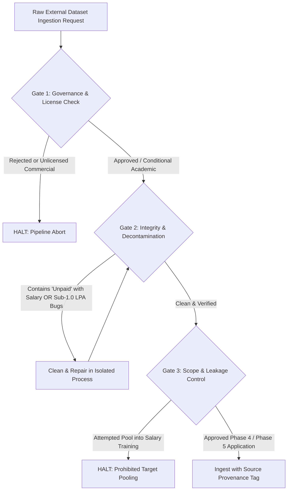

# JobRadar — External Dataset Risk Register

> **Document Type:** Data Governance & ML Safety Risk Register  
> **Status:** ACTIVE GOVERNANCE DOCUMENT (POST-AUDIT REVIEW)  
> **Project:** JobRadar — Indian Tech Job Market Analysis and Career Intelligence Platform  
> **Repository Root:** `JobRadar/DDS-Job-Market-Project`  
> **Review Date:** 2026-11-11  

---

## 1. Risk Register Overview & Governance Boundary

This Risk Register establishes formal controls, severity classifications, and mandatory mitigation protocols for all external datasets cataloged in JobRadar. Every risk identified during Steps 1 through 4B is documented with its technical mechanism, failure modes, and enforceable engineering gates.

### 1.1 Technical Health vs. Data Governance Status

* **Technical Execution Blockers:** **Zero Technical Blockers**. All physical files exist, 100% of cryptographic SHA-256 hashes are verified, zero files are corrupt, and the full repository test suite (**244 / 244 tests**) passes without error.
* **Data-Governance & Licensing Status:** **Active Governance Constraints**. Significant legal, provenance, and data-integrity risks exist regarding third-party scraped content, unverified licenses, and synthetic salary imputation. These risks require active enforcement of pipeline gates before any downstream ingestion.

### 1.2 Severity Classification Matrix

| Severity Level | Definition | Active Risks |
|---|---|:---:|
| **CRITICAL** | Direct corruption of model weights, target leakage, synthetic data ingestion, or legal/licensing breach. Must block pipeline execution. | **3** |
| **HIGH** | Distribution skew, data leakage across validation folds, unannualized metrics, or survivorship bias. | **3** |
| **MEDIUM** | Macro vs micro comparability limits, platform bias (open-source only), or incomplete sample sizes. | **3** |
| **LOW** | Minor rounding variances, non-critical metadata omissions, or documentation gaps. | **1** |
| **Total Tracked Risks** | | **10** |

---

## 2. Comprehensive Risk Register

| Risk ID | Dataset | Risk Description | Severity | Potential Impact | Mandatory Engineering Mitigation | Governance Status |
|---|---|---|:---:|---|---|:---:|
| **RSK-EXT-01** | **Kaggle Tech 23K** (`indian_tech_jobs_2026.csv`) | **Synthetic Salary Imputation in Unpaid Roles:** 306 records with `salary_raw == "Unpaid"` have `salary_disclosed == True` and are assigned `salary_min_lpa = 10.0`, `salary_max_lpa = 18.0`, `salary_midpoint_lpa = 14.0`. **Empirically verified: 0 overlap with the 105 sub-1.0 LPA records.** | **CRITICAL** | Model learns false salary associations for unpaid internships; artificially bloats Phase 6 salary predictions at 14.0 LPA. | **Strict Quarantine:** Kaggle dataset is blocked from Phase 6 training. Any future ingestion script must execute an assert check: `assert (df['salary_raw'] == 'Unpaid').sum() == 0` after discarding unpaid rows. | **ACTIVE QUARANTINE** (Enforced) |
| **RSK-EXT-02** | **Kaggle Tech 23K** (`indian_tech_jobs_2026.csv`) | **Sub-1.0 LPA Anomalies & Inverted Regexes:** 105 records have `salary_midpoint_lpa < 1.0`. These comprise: **2 zero-salary invalid records** (`"0 PA"`, midpoint = 0.0 LPA); **40 unannualized monthly stipends** (e.g. `"20,000/month"` parsed as 0.20 LPA); **36 corrupted mixed-range regex inversions** (e.g. `"50,000-15 Lacs PA"` parsed as 0.25 LPA); and **27 genuine low annual salaries/ranges**. | **HIGH** | Downward bias on junior salary predictions; severe target contamination on senior executive roles (e.g. Engineering Director midpoint = 0.30 LPA). | Ingestion preprocessor must repair monthly stipends ($\times 12$), re-parse mixed ranges using verified regex, and discard zero-salary rows before computing training targets. | **ACTIVE QUARANTINE** (Enforced) |
| **RSK-EXT-03** | **Kaggle Tech 23K** (`indian_tech_jobs_2026.csv`) | **Shared Upstream Platform Provenance (Naukri.com Overlap):** Kaggle dataset was scraped from Naukri.com, sharing 76 exact 12-digit Naukri IDs and 2,064 employers (29.74% of Kaggle companies) with JobRadar core dataset. | **HIGH** | Data leakage between train and test sets if Kaggle is used as an "independent" out-of-distribution evaluation set; inflated generalization claims. | Kaggle must be governed as a *temporal/vertical expansion set*, not an independent distribution. Deduplication by Naukri ID and GroupKFold by company must be enforced across pooled data. | **DOCUMENTED RESTRICTION** |
| **RSK-EXT-04** | **Kaggle Tech 23K** (`indian_tech_jobs_2026.csv`) | **Target Leakage from Publisher-Derived Columns:** Dataset includes publisher-engineered features: `salary_tier`, `salary_midpoint_lpa`, `experience_tier`, `skill_domain`, and `is_senior`. | **CRITICAL** | If publisher-engineered categorical tiers or midpoints enter feature matrix $X$, the model suffers catastrophic target leakage. | Explicit feature whitelist in `trainer.py`. All columns matching `salary_*`, `*_tier`, or derived groupings are forbidden from feature matrices. | **GOVERNANCE GATE ACTIVE** |
| **RSK-EXT-05** | **Stack Overflow 2024** (`survey_results_public.csv`) | **Self-Reported Compensation vs Employer Base CTC Mismatch:** Stack Overflow's `CompTotal` measures total annual comp (including bonuses, equity, and perks) for incumbent tenured developers in mid-2024; JobRadar measures employer base CTC bids for new hires in 2025–2026. | **HIGH** | Extreme prediction errors if survey figures are trained alongside job postings; equity and retention bonuses distort market base hiring rates. | **Strict Boundary:** Stack Overflow compensation is classified as a *Macroeconomic Benchmark*. It is permanently forbidden from being pooled into job-posting regression datasets. | **PERMANENT BOUNDARY ENFORCED** |
| **RSK-EXT-06** | **All Scraped & Community Datasets** (Kaggle, Fliar, Jobspiq, JobTether, Tevos, Role Radar) | **Unverified Third-Party Licensing & Scraped Content Rights:** Publisher-declared licenses (e.g. CDLA on Kaggle) do **not** automatically grant rights over scraped source-platform content (Naukri.com ToS). Benchmarks from Fliar, Jobspiq, JobTether, and Tevos lack formal license texts in the repository. | **CRITICAL** | Legal or compliance exposure if derived databases are redistributed publicly or used commercially beyond academic research fair use. | **Academic Research Fence:** All such datasets are restricted strictly to non-commercial, internal academic evaluation. No raw text or commercial API redistribution permitted. | **GOVERNANCE RESTRICTION ACTIVE** |
| **RSK-EXT-07** | **GitHub Innovation Graph** (`languages.csv`) | **Activity-versus-Employment Interpretation Gap:** `num_pushers` tracks unique accounts pushing to *public repositories only*, excluding private enterprise repositories (>80% of Indian commercial software). High student/hobbyist presence inflates HTML, CSS, and basic Python counts. | **MEDIUM** | Over-recommending beginner tools in Phase 5 career pathways; false assumption that high public git pusher volume equals high job openings. | Innovation Graph data is approved strictly for *technology momentum weighting* and longitudinal ecosystem trends. It must never be used as a 1:1 proxy for commercial vacancy counts or salary levels. | **USAGE CONSTRAINED** |
| **RSK-EXT-08** | **Fliar Sample** (`india_salary_benchmarks_2026_sample.csv`) | **Sample Truncation & Discrepancy from Advertised Size:** Downloaded file contains 12,958 rows, whereas upstream marketing claimed a 49,355-record benchmark. Data consists of pre-binned percentiles. | **MEDIUM** | Incomplete statistical coverage across niche roles; statistical variance in small regional slices. | Restricted to exploratory salary band cross-checking. Prohibited from being used as a primary training set for continuous regression models. | **CONDITIONALLY CONSTRAINED** |
| **RSK-EXT-09** | **ITCI 2026** (`indian_tech_career_intelligence_2026.csv`) | **Synthetic Pseudo-Random Generation Contamination:** 100,000-row dataset generated from flat uniform random distributions with ungrounded experience-to-salary pairings. | **CRITICAL** | If ingested, completely destroys ML model calibrations, learned coefficients, and market realism. | **Physical Quarantine:** Permanently segregated in `data/external/rejected/synthetic_itci_2026/`. Blocked by ingestion filters; zero database imports permitted. | **PERMANENTLY QUARANTINED** |
| **RSK-EXT-10** | **Headcount Labs** (Skipped Candidate) | **Missing / Inaccessible Commercial Asset:** Candidate identified during Step 2 discovery was commercial, requiring gated enterprise agreements and NDAs. | **LOW** | Minor gap in proprietary executive compensation benchmarking. | Formally skipped during Step 3; non-issue as public datasets (JobRadar core, Kaggle clean, Stack Overflow, Fliar) provide sufficient empirical coverage. | **CLOSED (SKIPPED)** |

---

## 3. Enforceable Governance Gates for Future Integration

To ensure that none of the above risks manifest during future development (e.g. Step 5 or subsequent phases), the following **Three Enforceable Engineering Gates** are formally mandated:

1. **Gate 1 (Provenance & Licensing Gate):**
   - Every external record ingested into `jobradar.db` must include its immutable `source_id` tag (`kaggle_tech_23k`, `stackoverflow_2024`, `github_innovation_graph`, `fliar_sample`, etc.).
   - Records with `source_id == 'rejected_itci'` are blocked by database trigger constraints.
   - Non-commercial research restrictions must be explicitly logged in database metadata.

2. **Gate 2 (Decontamination & Parsing Gate):**
   - No record from `kaggle_tech_23k` may enter any feature pipeline without passing the clean filter:
     $$\text{salary\_raw} \neq \text{'Unpaid'} \quad\wedge\quad \text{salary\_midpoint\_lpa} \ge 1.0 \quad\wedge\quad \text{salary\_min\_lpa} \le \text{salary\_max\_lpa}$$
   - Any repair of monthly stipends ($\times 12$) must write to a distinct, audit-logged processed directory (`data/external/kaggle_tech_23k/processed/`), preserving the original raw file in perpetuity.

3. **Gate 3 (Target Leakage & Isolation Gate):**
   - The Phase 6 salary training pipeline (`JobRadar/AI_ML/Phase_6_Salary_Prediction/data/curator.py`) must enforce a strict feature blacklist prohibiting any derived column from external sources (`salary_tier`, `experience_tier`, `skill_domain`, etc.).
   - Stack Overflow compensation data must never be mapped to the `salary_midpoint_lpa` training target.

---

## 4. Reviewer Approval & Sign-Off

* **Lead Reviewer:** Independent Senior Data Scientist, Data Engineer, and Data Governance Reviewer
* **Technical Health:** 0 Technical Blockers (100% hashes verified, 244/244 tests passing).
* **Governance Status:** **ACTIVE CONSTRAINTS ENFORCED**. Kaggle salary quarantined; Stack Overflow fenced as macro benchmark; scraped content restricted to academic research.
