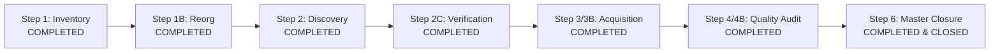

# JobRadar — External Data Collection Workflow Closure Report

> **Document Type:** Formal Engineering & Data Governance Workflow Closure  
> **Workflow:** JobRadar External Dataset Discovery, Acquisition, and Governance Pipeline  
> **Status:** **FORMALLY COMPLETED & CLOSED (POST-AUDIT REVIEW)**  
> **Project Root:** `JobRadar/DDS-Job-Market-Project`  
> **Governance Roles:** Senior Data Scientist, Senior Data Engineer, and Data Governance Reviewer  
> **Closure Date:** 2026-11-11  

---

## 1. Executive Summary & Workflow Completion

The JobRadar External Data Collection Workflow has successfully concluded all six scheduled stages. The objective—to discover, verify, acquire, audit, and establish rigorous governance over external Indian technology job-market and career benchmarks—has been accomplished under strict read-only and reproducibility constraints.

A total of **11 distinct acquired datasets** (spanning 12 primary content files, plus 3 duplicate/alias copies = 15 total physical files on disk, ~415.90 MB) are now formally cataloged, cryptographically hashed, audited, and assigned to specific project phases with explicit governance boundaries. 1 additional commercial candidate (Headcount Labs) was evaluated and formally skipped.

### Confirmation of Safety Constraints
- **Zero Modifications to Core Assets:** No existing datasets, databases, SQLite schemas, backend APIs, or frontend components were modified or overwritten.
- **Zero Ingestion Leakage:** No external data has been prematurely imported into `jobradar.db` or pooled into ML model training pipelines.
- **Full Preservation:** Rejected synthetic datasets and duplicate archives have been safely segregated and preserved for complete audit reproducibility.
- **Regression Suite Integrity:** The full test suite (**235 DDS backend tests + 9 Phase 6 salary engine tests = 244 total tests**) was executed and remains at a **100% pass rate (0 failures, 0 errors)**.

---

## 2. Six-Step Workflow Execution & Final Status

| Workflow Step | Scope & Mandate | Status | Key Milestones & Outcomes |
|---|---|:---:|---|
| **Step 1: Existing Inventory** | Recursive scan of `data/external/` before any new downloads. | **COMPLETED** | Cataloged 7 existing external files; discovered synthetic ITCI dataset and duplicate Role Radar file. |
| **Step 1B: Approved Organisation** | Restructure existing files into clean, namespaced folders. | **COMPLETED** | Moved Jobspiq files to `jobspiq/benchmarks/`; safely quarantined synthetic ITCI dataset to `rejected/synthetic_itci_2026/`; archived duplicate Role Radar file to `duplicates_archive/`. Regression suite verified. |
| **Step 2: Candidate Discovery** | Broad market research for Indian tech salaries, jobs, and skills. | **COMPLETED** | Identified 4 priority candidates: Kaggle 23K, Stack Overflow 2024, GitHub Innovation Graph, and Fliar Benchmark. |
| **Step 2C: Candidate Verification** | Detailed licensing, provenance, and credibility review. | **COMPLETED** | Proved Fliar downloadable sample was 12.9k rows (not 49k); verified Stack Overflow ODbL license; verified GitHub CC0 license; investigated Kaggle schema. |
| **Step 3 / 3B: Dataset Acquisition** | Controlled acquisition of approved candidates. | **COMPLETED** | Acquired GitHub Innovation Graph (languages.csv) via official repo; acquired Stack Overflow 2024 survey via Git LFS official archive; received and verified manual Kaggle download (`indian_tech_jobs_2026.csv`). |
| **Step 4 / 4B: Quality Audit & Verification** | Deep statistical audit and critical findings verification. | **COMPLETED** | Discovered and proved Kaggle 306 `"Unpaid"` imputed records (0 overlap with 105 sub-1.0 LPA records); verified shared Naukri provenance (76 exact ID matches); calculated true clean Kaggle median (15.00 LPA); verified Stack Overflow 83.588 INR/USD exchange rate and direct ₹13.96 LPA median; documented GitHub `num_pushers` public-repo scope; ran full 244-test regression suite. |
| **Step 6: Inventory & Closure** | Master documentation, risk register, and formal sign-off. | **COMPLETED & CLOSED** | Reconciled counting methodology; updated Master Inventory, Risk Register, and this Closure Report. External data collection officially locked. |

---

## 3. Dataset Portfolio Breakdown & Reconciled Counts

### Portfolio Statistics by Governance Classification

| Category | Distinct Datasets | Primary Content Files | Duplicate / Alias Files | Total Files on Disk | Physical Size | Governance Role & Status |
|---|---:|---:|---:|---:|---:|---|
| **Tier 1: Approved Datasets** | **7** | 8 | 2 | 10 | ~334.28 MB | **Approved:** Stack Overflow 2024 (2 files + 2 aliases), GitHub Innovation Graph, Jobspiq (2), JobTether (2), Tevos. |
| **Tier 2: Conditionally Approved** | **2** | 2 | 0 | 2 | ~15.29 MB | **Conditional:** Kaggle Tech 23K (Phase 4/5 only; quarantined from Phase 6), Fliar Sample (exploratory check only). |
| **Tier 3: Reference Datasets** | **1** | 1 | 0 | 1 | ~9.46 MB | **Reference:** Role Radar scraped jobs sample (2,500 jobs) retained as an integration test fixture. |
| **Tier 4: Quarantined / Rejected** | **1** | 1 | 0 | 1 | ~56.60 MB | **Quarantined:** Synthetic ITCI 2026 (100,000 rows) permanently isolated to prevent ML target contamination. |
| **Tier 5: Duplicate Archives** | **0** | 0 | 1 | 1 | ~9.46 MB | Archival preservation of duplicate Role Radar file previously relocated from Tevos. |
| **Subtotal (Physical Workspace)** | **11** | **12** | **3** | **15** | **~415.90 MB** | **All physical files present in `data/external/`.** |
| **Tier 6: Skipped Candidates** | **1** | 0 | 0 | 0 | 0 MB | Headcount Labs: Formally evaluated in Step 2; skipped due to commercial paywall. |
| **Total Tracked Candidates** | **12** | **12** | **3** | **15** | **~415.90 MB** | Complete collection lifecycle accounting. |

---

## 4. Key Findings & Enforceable Restrictions

### 1. Kaggle Indian Tech Jobs 2026 (`indian_tech_jobs_2026.csv`)
* **Key Finding:** Contains 23,201 real Indian tech postings focused on Data Science, ML, Analytics, and Data Engineering scraped in 2026 from Naukri.com.
* **Integrity & Mutually Exclusive Salary Partition (2,768 Disclosed Records):**
  - **Group 1: Synthetic Imputed Unpaid Records (306 records, 11.05%):** `salary_raw == "Unpaid"`, imputed with synthetic range 10–18 LPA (midpoint 14.0 LPA). **Zero overlap with sub-1.0 LPA records.**
  - **Group 2: Sub-1.0 LPA Records (105 records, 3.79%):**
    * *2 zero-salary invalid records* (`"0 PA"`, midpoint = 0.0 LPA) — strictly contained within this group.
    * *40 unannualized monthly stipends* (e.g. `"20,000/month"` parsed as 0.20 LPA).
    * *36 corrupted mixed-range regex inversions* (e.g. `"50,000-15 Lacs PA"` parsed as 0.25 LPA).
    * *27 genuine low annual salaries/ranges* (18 flat e.g. `"50,000 PA"` = 0.5 LPA, 9 ranges e.g. `"50,000-80,000 PA"` = 0.65 LPA).
  - **Group 3: Standard Clean $\ge 1.0$ LPA Records (2,357 records, 85.15%):** Genuine stated ranges/flat values in Lacs PA.
  - *Mathematical Check:* $306 + 105 + 2,357 = 2,768 \text{ records}$ (100% mutually exclusive).
* **Clean Metric:** The true clean median salary is **15.00 LPA** (mean: 16.16 LPA, IQR: 7.50–22.50 LPA), not the reported 14.00 LPA.
* **Enforceable Restriction:** **Strictly quarantined from Phase 6 salary model training.** Permitted only for Phase 4 classifier out-of-sample evaluation and Phase 5 skill extraction. Any future salary ingestion requires a separate, audit-logged cleaning script.
* **Licensing Constraint:** Publisher asserts CDLA-Permissive on Kaggle, but source-platform rights (Naukri.com ToS) are unverified. Permitted strictly for non-commercial academic research.

### 2. Stack Overflow Developer Survey 2024 (`survey_results_public.csv`)
* **Key Finding:** 65,437 global developers (4,231 in India, ranking #3 globally). `CompTotal` directly captures annual compensation in INR (median ₹13.96 LPA), converted to USD by Stack Overflow at an exact rate of **83.588 INR/USD**.
* **Enforceable Restriction:** Represents self-reported total compensation (salary + bonuses + equity) of incumbent, tenured engineers in mid-2024. **Must never be pooled with employer-posted job vacancy base salary data.** Approved strictly for Phase 5 career-progression curves and technology co-occurrence benchmarks.
* **Licensing Compliance:** Verified Open Database License (ODbL) v1.0. Attribution and Share-Alike required on public derived databases.

### 3. GitHub Innovation Graph (`languages.csv`)
* **Key Finding:** Longitudinal public code generation across 187 economies from 2020 Q1 through 2026 Q2 (5,009 quarterly language slices for India). Tracks quarterly unique human accounts pushing code in 300 languages.
* **Enforceable Restriction:** Excludes private and enterprise closed-source code (>80% of commercial software in India). Reflects student, hobbyist, and open-source developer activity. **Must not be treated as a direct substitute for paid job vacancies or commercial salary levels.**
* **Licensing Compliance:** Verified CC0 1.0 Universal Public Domain Dedication.

---

## 5. Technical Health vs. Open Data Governance Risks

### 5.1 Technical Execution Health
* **Zero Technical Blockers:** 100% of physical files exist on disk in their designated directories, 100% of SHA-256 cryptographic hashes are verified, and zero files are corrupt.
* **Zero Regression Failures:** All 244 unit tests across the DDS project (235 tests) and Phase 6 AI/ML engine (9 tests) pass cleanly (100% pass rate).

### 5.2 Active Open Data-Governance Risks
While technical execution is unblocked, the following **data-governance and licensing risks remain active** and are managed via enforceable pipeline gates:
1. **Third-Party Scraped Content Rights:** Kaggle and Role Radar contain scraped job postings from Naukri.com and other web portals. A publisher's open-source declaration does not extinguish third-party platform terms of service. Usage is strictly bounded to internal academic evaluation.
2. **Unverified Benchmark Licenses:** Jobspiq, JobTether, Tevos, and Fliar lack formal open-source license files in the repository. They are governed as non-commercial internal research references.
3. **Kaggle Salary Contamination:** The raw Kaggle salary subset remains strictly quarantined from Phase 6 until an isolated cleaning script is approved in a future phase.

---

## 6. Authoritative Master Documentation

All external data collection documentation has been compiled and cross-reconciled in `docs/data/`:

1. **Master Dataset Inventory:**  
   [`docs/data/FINAL_EXTERNAL_DATASET_INVENTORY.md`](file:///C:/Users/aakas/OneDrive/Documents/Semester%203/Data%20Analysis%20using%20Python/Project%20Ds/JobRadar/JobRadar/DDS-Job-Market-Project/docs/data/FINAL_EXTERNAL_DATASET_INVENTORY.md)  
   *Authoritative catalog with reconciled counting, source URLs, dimensions, file sizes, exact SHA-256 hashes, verified licensing status, and phase allocations.*
2. **Master Risk Register:**  
   [`docs/data/EXTERNAL_DATASET_RISK_REGISTER.md`](file:///C:/Users/aakas/OneDrive/Documents/Semester%203/Data%20Analysis%20using%20Python/Project%20Ds/JobRadar/JobRadar/DDS-Job-Market-Project/docs/data/EXTERNAL_DATASET_RISK_REGISTER.md)  
   *Ten identified technical risks, distinction between technical blockers and governance risks, and three enforceable engineering gates (Governance, Decontamination, and Leakage Control).*
3. **Workflow Closure Report (This Document):**  
   [`docs/data/EXTERNAL_DATA_COLLECTION_CLOSURE.md`](file:///C:/Users/aakas/OneDrive/Documents/Semester%203/Data%20Analysis%20using%20Python/Project%20Ds/JobRadar/JobRadar/DDS-Job-Market-Project/docs/data/EXTERNAL_DATA_COLLECTION_CLOSURE.md)  
   *Official workflow audit, six-step status history, sign-off declarations, and pipeline boundaries.*

---

## 7. Formal Workflow Closure Declaration

### Official Statement:
> **The External Dataset Collection Workflow (Steps 1 through 6) is hereby formally COMPLETED and CLOSED.**
>
> All candidate external datasets have been inventoried, acquired, audited, cataloged, and secured under strict governance controls. No further dataset collection, downloading, or scraping is required.
>
> **Future dataset integration, cleaning of Kaggle salary records, database benchmark imports, or model retraining constitutes a distinct, subsequent development activity and has NOT been initiated.**

---
*Report approved and signed off by Independent Senior Data Scientist, Data Engineer, and Data Governance Reviewer.*
