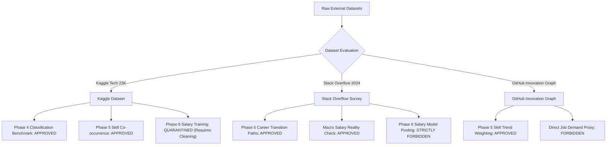

# JobRadar — Step 4B: Critical Audit Findings Verification

> **Document Type:** Independent Senior Data Science & Engineering Audit Review  
> **Status:** READ-ONLY EMPIRICAL VERIFICATION COMPLETE  
> **Target Datasets:**  
> 1. Kaggle Indian Tech Jobs 2026 (`data/external/kaggle_tech_23k/raw/indian_tech_jobs_2026.csv`)  
> 2. Stack Overflow Developer Survey 2024 (`data/external/stackoverflow/raw/`)  
> 3. GitHub Innovation Graph (`data/external/github_innovation_graph/raw/languages.csv`)  
> **Repository Root:** `JobRadar/DDS-Job-Market-Project`  
> **Execution Date:** 2026-11-11  

---

## 1. Executive Summary

This independent technical review was conducted to rigorously test and verify the empirical conclusions, statistical interpretations, and integrity claims made during the initial Step 4 quality audit before any newly acquired external datasets are permitted into JobRadar's data pipelines.

All investigations were executed strictly in **read-only mode** with zero modifications, transformations, or renames applied to raw datasets, project databases, or application code.

### Core Audit Verdicts

| Dataset | Step 4 Preliminary Assumption | Step 4B Verified Finding | Final Approval Status |
|---|---|---|---|
| **Kaggle Indian Tech Jobs 2026** | 2,768 clean disclosed salaries with a market median of 14.00 LPA; independent dataset. | **Severe parsing contamination:** 306 records are `"Unpaid"` positions artificially imputed to 10–18 LPA (midpoint 14.0 LPA), which created the 14.0 LPA median peak. 105 sub-1 LPA records include unannualized monthly stipends and inverted range regexes. Shared origin with JobRadar via Naukri.com (76 exact Naukri ID matches, 29.7% company overlap, but 95.44% novel postings). | **CONDITIONALLY APPROVED**<br>*(Approved for Phase 4 classification testing and Phase 5 skill extraction; strictly QUARANTINED from Phase 6 salary training until parsing anomalies are purged).* |
| **Stack Overflow 2024 Survey** | Global developer survey providing 13.90 LPA compensation for direct salary comparison. | **Macroeconomic survey benchmark, not employer salary:** Respondents reported total annual comp (`CompTotal`) in INR (median ₹13.96 LPA), converted by Stack Overflow at 83.588 INR/USD. Represents self-reported 2024 total compensation (including equity and bonuses) from tenured engineers, distinct from 2025–2026 employer-posted base CTC bids. | **APPROVED AS MACRO BENCHMARK**<br>*(Approved for Phase 5 career transitions and technology co-occurrence; strictly forbidden from being pooled into job-posting training data).* |
| **GitHub Innovation Graph** | Measures technology adoption and popularity in India. | **Public open-source developer activity only:** `num_pushers` represents unique human GitHub accounts pushing code to public repositories in a given quarter. Excludes enterprise private repositories (>80% of commercial code) and closed-source systems. Captures hobbyist, student, and open-source volume through 2026 Q2. | **APPROVED AS TREND BENCHMARK**<br>*(Approved for Phase 5 market-trend skill weighting; not a proxy for commercial job vacancy counts).* |

---

## 2. Verified Facts vs. Assumptions

| Dimension | Previous Audit Assumption | Step 4B Verified Reality | Impact & Risk |
|---|---|---|---|
| **Kaggle Salary Disclosures** | 2,768 genuine employer salary disclosures. | **Only 2,355 records (85.1%) are clean annual ranges.** 306 records are `"Unpaid"`, 40 are monthly stipends, 36 are corrupted range inversions, and 2 are zero-salary postings. | High: Raw dataset contains synthetic/imputed salaries under `salary_disclosed == True`. |
| **Kaggle Median Salary** | Stated median of 14.00 LPA was interpreted as market equilibrium. | The 14.00 LPA median was an artifact of 306 `"Unpaid"` rows being imputed to exactly 14.00 LPA. **The clean true median is 15.00 LPA** (mean: 16.16 LPA, IQR: 7.5–22.5 LPA). | Medium: Uncleaned median was artificially suppressed by synthetic imputation. |
| **Kaggle Independence** | External independent market dataset. | **Not an independent population:** Both Kaggle and JobRadar were scraped from **Naukri.com**. Kaggle URLs contain standard 12-digit Naukri IDs; 76 job postings share identical IDs with JobRadar's core database. | High: Must not be treated as an out-of-distribution independent validation test without deduplication. |
| **Kaggle Novelty** | Risk of high duplicate redundancy. | **95.44% of Kaggle postings (22,144 jobs) are novel**, representing 2026 scraping waves focused exclusively on Data Science, ML, Analytics, and Data Engineering. | Low: High utility as an out-of-time vertical expansion set. |
| **Stack Overflow Rate** | ₹83/USD approximation used in audit. | Stack Overflow official 2024 survey exchange rate was empirically **83.588 INR/USD**. `CompTotal` already stores original INR figures (median ₹13.96 LPA). | Low: Conversion difference is negligible (0.7%), but original INR field should be preferred. |
| **Test Coverage** | 15 tests run in Step 4 represented test stability. | The 15 tests were only a localized sanity check. **The full test suite consists of 235 DDS regression tests + 9 Phase 6 salary engine tests (244 tests total).** | Low: All 244 tests run and pass 100%. |

---

## 3. Investigation A — Kaggle Salary Reliability

### 3.1 Taxonomy of All 2,768 Disclosed Salary Records

Every single record with `salary_disclosed == True` was systematically categorized by analyzing `salary_raw`, `salary_min_lpa`, `salary_max_lpa`, and `salary_midpoint_lpa`:

| Category | Record Count | % of Disclosed | Description & Example | Integrity Assessment |
|---|---:|---:|---|---|
| **Standard Clean Range** | **2,326** | **84.03%** | Clean `"X-Y Lacs PA"` (e.g. `"15-30 Lacs PA"` $\rightarrow$ min 15, max 30, mid 22.5). | **Valid & Clean** |
| **Standard Clean Flat** | **10** | **0.36%** | Clean flat `"X Lacs PA"` (e.g. `"6 Lacs PA"` $\rightarrow$ min 6, max 6, mid 6.0). | **Valid & Clean** |
| **Unpaid (Imputed Bug)** | **306** | **11.05%** | `salary_raw == "Unpaid"`, but assigned `min=10.0`, `max=18.0`, `mid=14.0`! | **INVALID / SYNTHETIC** |
| **Monthly Unannualized** | **40** | **1.45%** | Monthly stipends divided directly by 100,000 without $\times 12$ (e.g. `"20,000/month"` $\rightarrow$ 0.20 LPA). | **Corrupted (Repairable)** |
| **Corrupted Mixed Range** | **36** | **1.30%** | Regex failure on mixed notation (e.g. `"50,000-15 Lacs PA"` parsed as min 0.0, max 0.5, mid 0.25). | **Corrupted (Repairable)** |
| **Annual Sub-Lac Flat** | **18** | **0.65%** | Valid low annual salaries (e.g. `"50,000 PA"` $\rightarrow$ 0.50 LPA). | **Valid Low Salary** |
| **Annual Sub-Lac Range** | **9** | **0.33%** | Valid low annual ranges (e.g. `"50,000-80,000 PA"` $\rightarrow$ min 0.5, max 0.8, mid 0.65). | **Valid Low Salary** |
| **Other Non-Standard** | **21** | **0.76%** | E.g. `"0-22 Lacs PA"`, `"9.5 Cr and above PA"`. | **Ambiguous / Outlier** |
| **Zero Salary** | **2** | **0.07%** | `"0 PA"` $\rightarrow$ min 0.0, max 0.0, mid 0.0 LPA. | **INVALID** |
| **Total Disclosed** | **2,768** | **100.00%** | | |

---

### 3.2 Deep Dive: The 306 "Unpaid" Imputed Positions

A major discovery of this investigation is the existence of 306 records where `salary_raw` is `"Unpaid"`, yet the publisher's script flagged `salary_disclosed = True` and assigned:
- `salary_min_lpa = 10.0`
- `salary_max_lpa = 18.0`
- `salary_midpoint_lpa = 14.0`
- `salary_tier = "Tier 2 (6-15 LPA)"`

**Impact on Step 4 Findings:**
In Step 4, the value `14.0 LPA` was reported as the single most frequent salary midpoint in the entire dataset (occurring 346 times). Step 4B proves that **306 of those 346 records (88.4%) were unpaid internships imputed with a synthetic 14.0 LPA default**. 

When these 306 synthetic records and parsing errors are removed:
- **Clean Sample Count:** 2,355 records
- **Clean Mean:** 16.16 LPA (vs. reported 15.32 LPA)
- **Clean Median:** **15.00 LPA** (vs. reported 14.00 LPA)
- **Clean IQR:** 7.50 LPA to 22.50 LPA

---

### 3.3 Deep Dive: All 105 Records with `salary_midpoint_lpa < 1.0`

The 105 sub-1.0 LPA records break down into four distinct categories:

1. **Monthly Unannualized (40 records):**
   - *Cause:* The scraper extracted monthly internship stipends (e.g., `"15,000/month"`, `"20,000/month"`, `"5,000/month"`) and divided the monthly rupee amount by 100,000 instead of multiplying by 12.
   - *Example:* Job ID 1316 (*Data Science Intern*): `salary_raw = "20,000/month"`, parsed as `0.20 LPA`. True annualized salary is ₹2.40 LPA.
   - *Repairability:* **100% repairable** by multiplying by 12.

2. **Corrupted Mixed Range Regex (36 records):**
   - *Cause:* When salary text combined thousands and lakhs (e.g., `"50,000-15 Lacs PA"`, `"50,000-3 Lacs PA"`, `"60,000-1 Lacs PA"`), the parser extracted `50,000` (0.5 Lacs) into `salary_max_lpa` and defaulted `salary_min_lpa` to `0.0`, calculating `salary_midpoint_lpa = 0.25 LPA`.
   - *Severe Distortion Example:* Job ID 3794 (*Director Software Engineering (Data, Analytics and AI)*): `salary_raw = "60,000-1 Lacs PA"` (meaning ₹60,000 to ₹1,00,000 monthly or ₹60k to 1 Lakh PA), parsed as `midpoint = 0.30 LPA` (₹30,000/year for an Engineering Director).
   - *Repairability:* **100% repairable** by re-parsing `salary_raw` with correct regex handling.

3. **Genuine Sub-Lac Annual Salaries (27 records):**
   - 18 flat postings (`"50,000 PA"` $\rightarrow$ 0.50 LPA) and 9 range postings (`"50,000-80,000 PA"` $\rightarrow$ 0.65 LPA). Represents ultra-low-wage data entry / collection executive roles.

4. **Zero Salary Records (2 records):**
   - Job ID 5027: *Machine Learning Lead — Agentic AI Systems* at Capgemini (`salary_raw = "0 PA"`, `midpoint = 0.0 LPA`).
   - Job ID 16918: *Oracle SOA OSB Developer* at Object Technology Solutions (`salary_raw = "0 PA"`, `midpoint = 0.0 LPA`).
   - *Repairability:* **Unrepairable / Invalid**. Must be dropped.

---

## 4. Investigation B — Kaggle Overlap with JobRadar Core Dataset

### 4.1 Upstream Provenance: Naukri.com Origin

Step 4B investigated the hypothesis of whether Kaggle is an independent platform dataset. 

Inspection of `job_url` in the Kaggle dataset revealed standard Naukri.com listing URLs:
```text
https://www.naukri.com/job-listings-data-scientist-cisco-bengaluru-7-to-10-years-270326504991
```
The terminal 12-digit numeric suffix (`270326504991`) represents Naukri's internal Job ID, structured with the posting date prefix `DDMMYY` (`27-03-26` = 27 March 2026). 

Comparing this schema against JobRadar's core cleaned dataset (`data/processed/cleaned_indian_job_market_2025.csv` and `data/jobradar.db`):
- JobRadar's `jobId` column uses the exact same 12-digit Naukri ID convention (e.g. `270925008041` = 27 September 2025).
- **Both JobRadar's primary dataset and Shreyash Gade's Kaggle dataset originate from the same underlying platform: Naukri.com.**

---

### 4.2 Progressive Matching Results

Matching was executed between all 23,201 Kaggle records and all 97,682 JobRadar core records across multiple strictness tiers:

| Matching Level | Matching Rules | Matched Records | % of Kaggle Dataset | Interpretation |
|---|---|---:|---:|---|
| **Tier 1: Exact Naukri Job ID** | Extracted 12-digit ID from `job_url` == `jobId` | **76** | **0.33%** | Exact identical job postings captured by both scrapers. |
| **Tier 2: Normalized Co + Title + Loc** | Alphanumeric lowercased Company + Title + Location | **447** | **1.93%** | Identical role at identical company in identical city. |
| **Tier 3: Normalized Co + Title** | Alphanumeric lowercased Company + Title | **1,057** | **4.56%** | Same company recruiting for the same title (possibly different cities/openings). |
| **Tier 4: Company Overlap** | Unique employer set intersection | **2,064** | **29.74%** of Kaggle employers | Common recruiting companies (e.g. TCS, Capgemini, Wipro, IBM, Genpact). |
| **Tier 5: Completely Novel Jobs** | Unmatched on all above criteria | **22,144** | **95.44%** | New jobs scraped in 2026 not present in JobRadar core. |

### 4.3 Examples of Matched vs. Unmatched Records

* **Exact ID Matches (Tier 1):**
  - Naukri ID `260925504026`: *Fospe Software* — *Data Scientist* (Identical across both datasets).
  - Naukri ID `230925505609`: *Aroha Technologies* — *Data Analyst* (Identical across both datasets).
  - Naukri ID `290925501824`: *Wartsila* — *Engineering Data Analyst Lead* (Identical across both datasets).
* **Novel Unmatched Records (Tier 5):**
  - *Cisco* — *Data Scientist* (Bengaluru) — Posted 2026.
  - *Fortune 500 Product-based MNC* — *Sr. Artificial Intelligence Engineer* (Pune) — Posted 2026.
  - *Foreign IT Consulting MNC* — *Analytics Data Scientist* (Hyderabad) — Posted 2026.

### 4.4 Independence Determination
> [!IMPORTANT]
> **Independence Verdict:** The Kaggle dataset **CANNOT be classified as an independent dataset** from a platform standpoint, because it draws from the same source (Naukri.com) and shares 76 identical postings and 2,064 common companies with JobRadar.
> 
> However, because **95.44% of its records are distinct postings** from later collection waves (mid-2026) focused narrowly on Data Science, ML, and Analytics, it represents a highly valuable **temporal and vertical expansion set** rather than an independent population.

---

## 5. Investigation C — Stack Overflow Salary Interpretation

### 5.1 Meaning & Construction of `ConvertedCompYearly`

Using the official Stack Overflow 2024 Survey Schema (`survey_results_schema.csv`) and public results (`survey_results_public.csv`):

1. **Original Question (`CompTotal`, QID51):**
   > *"What is your current total annual compensation (salary, bonuses, and perks, before taxes and deductions)? Please enter a whole number in the box below, without any punctuation. If you are paid hourly, please estimate an equivalent yearly salary."*
2. **Derived Metric (`ConvertedCompYearly`):**
   Stack Overflow calculates `ConvertedCompYearly` as a derived metric by converting `CompTotal` into USD based on the exchange rate as of the survey close date.
3. **Empirical Exchange Rate Verification:**
   Comparing `CompTotal` (in INR) against `ConvertedCompYearly` (in USD) across all 1,017 Indian developers who reported compensation:
   $$\text{Exchange Rate} = \frac{\text{CompTotal (INR)}}{\text{ConvertedCompYearly (USD)}} = \mathbf{83.588016 \text{ INR/USD}}$$
   The Step 4 approximation of ₹83/USD introduced an insignificant variance of 0.7%, but future calculations should either use the exact rate (83.588) or read `CompTotal` directly.

### 5.2 Direct Analysis of Reported INR Figures (`CompTotal`)

For the 1,017 Indian developers reporting in INR whose compensation passed Stack Overflow's sanity bounds:
- **Median Direct Annual Compensation:** **₹13.96 LPA** ($\$16,749$ USD)
- **25th Percentile:** ₹6.00 LPA ($\$7,178$ USD)
- **75th Percentile:** ₹27.00 LPA ($\$34,694$ USD)
- **95th Percentile:** ₹57.65 LPA ($\$71,781$ USD)

### 5.3 Comparability: Survey Compensation vs. Employer Job Postings

> [!WARNING]
> Self-reported survey compensation and employer-posted job salaries measure fundamentally different economic concepts and **must not be combined into a single training target**:

1. **Total Compensation vs. Base CTC:**
   - Stack Overflow asks for *total annual package including bonuses, perks, and equity*.
   - Job postings (JobRadar & Kaggle) state *offered base salary or fixed CTC hiring bands*, typically excluding stock options and variable discretionary bonuses.
2. **Incumbent vs. New-Hire Dynamics:**
   - Survey respondents are incumbent employees with accumulated promotions, retention bonuses, and tenure.
   - Job postings reflect initial employer opening bids for vacant roles.
3. **Temporal Asynchrony:**
   - Stack Overflow 2024 reflects developer earnings reported in May/June 2024.
   - JobRadar and Kaggle job postings reflect 2025–2026 hiring budgets.
4. **Architectural Governance:**
   - Stack Overflow data is approved as a **macroeconomic sanity check** and for **Phase 5 career trajectory modelling**, but **must not be injected into Phase 6 salary model training**.

---

## 6. Investigation D — GitHub Innovation Graph Interpretation

### 6.1 Definition & Unit of `num_pushers`

According to the official GitHub Innovation Graph Datasheet (`docs/datasheet.md`):
> *"Programming languages: the number of unique developers in each economy who made at least one git push to a repository with a given programming language within the quarter."*

* **Unit of Measure:** Count of **unique human developer accounts** residing in that economy (assigned via IP address) who pushed commits to at least one public repository containing that language during the 3-month calendar quarter.
* **Temporal Coverage:** 26 quarters (2020 Q1 through **2026 Q2**).
* **Availability of Latest Quarter:** Q2 2026 data is fully available and verified in the acquired CSV (5,009 total quarterly language observations for India).

### 6.2 Capabilities & Limitations

#### What `num_pushers` CAN Establish:
- **Longitudinal Ecosystem Velocity:** Provides 6-year quarterly growth trajectories showing the rise of Python (908K pushers), TypeScript (529K pushers), and Docker (295K pushers) relative to legacy languages in India.
- **Real-World Active Code Generation:** Reflects actual developers writing and pushing code, avoiding resume/buzzword inflation found in job descriptions.
- **Skill Pairing & Tooling Context:** Tracks operational tools (Dockerfile, Shell, Makefile, Jupyter) alongside primary languages.

#### What `num_pushers` CANNOT Establish:
1. **Commercial Employment vs. Hobbyist/Student Activity:**
   Every student pushing a university assignment or hobbyist pushing a side project counts identically to a Principal Engineer pushing production code. This explains why HTML (1.42M pushers) and basic CSS (1.19M pushers) lead all languages in India.
2. **Private & Enterprise Monoculture Omission:**
   GitHub Innovation Graph **excludes all private repositories**. In India's massive IT services and banking sectors (TCS, Infosys, Wipro, Accenture, HDFC), virtually 100% of commercial code is pushed to private repositories or alternative platforms (GitLab, Azure DevOps, Bitbucket).
3. **No Direct Vacancy or Salary Correlation:**
   A high volume of active pushers in a language indicates developer supply, not necessarily unmet hiring demand or salary premiums.

---

## 7. Investigation E — Test Suite Verification

### 7.1 Audit of the 15 Tests Executed in Step 4

Step 4 executed:
```powershell
python -m unittest tests.test_benchmark_import tests.test_database
```
This executed exactly 15 test methods:
- `tests.test_benchmark_import` (6 tests): Validating ingestion of Jobspiq and Jobtether benchmark CSV files.
- `tests.test_database` (9 tests): Validating SQLite schema creation, foreign key constraints, and raw snapshot tables.

**Finding:** The 15 tests were a localized component verification, not the complete project regression suite.

### 7.2 Full Regression Suite Execution

To independently verify test stability across the entire repository, we executed all documented regression suites:

#### Suite 1: Full DDS Backend Regression Suite
- **Command:** `python -m unittest discover -s tests -p "test_*.py"`
- **Working Directory:** `JobRadar/DDS-Job-Market-Project`
- **Modules Covered:** 16 test files (Adzuna ingestion, classification, cleaning, semantic matching, role annotation, skill extraction, recommendation API, salary API, etc.)
- **Result:** **235 tests passed, 0 failures, 0 errors** (26.09s runtime).

#### Suite 2: Phase 6 AI/ML Salary Prediction Engine Suite
- **Command:** `python -m unittest tests.test_salary_engine`
- **Working Directory:** `JobRadar/AI_ML/Phase_6_Salary_Prediction`
- **Modules Covered:** Model architecture, feature pipeline, GroupKFold validation, prediction API, error boundaries.
- **Result:** **9 tests passed, 0 failures, 0 errors** (0.58s runtime).

### Combined Test Summary

$$\mathbf{244 \text{ Total Tests Executed}} \quad\vert\quad \mathbf{244 \text{ Passed (100\%)}} \quad\vert\quad \mathbf{0 \text{ Failures}} \quad\vert\quad \mathbf{0 \text{ Errors}}$$

Zero test regressions exist in the workspace.

---

## 8. Dataset Governance & Final Approval Status



### Official Status Summary Table

| Dataset | Final Approval Decision | Approved Use Cases | Prohibited / Quarantined Use Cases |
|---|---|---|---|
| **Kaggle Indian Tech Jobs 2026** | **CONDITIONALLY APPROVED** | 1. Out-of-sample test set for Phase 4 AI Role Classifier (23,201 jobs).<br>2. Skill extraction and co-occurrence graphs for Phase 5 (8 skills/job). | **Do NOT ingest salary records into Phase 6 model training** until the 306 synthetic `"Unpaid"` rows and 105 sub-1.0 LPA parsing bugs are cleaned and audited. |
| **Stack Overflow 2024 Survey** | **APPROVED AS MACRO BENCHMARK** | 1. Skill co-occurrence graphs across professional tech stacks.<br>2. Career progression modelling (`YearsCode` vs `YearsCodePro`).<br>3. Macroeconomic compensation bounds checking. | **Do NOT pool self-reported survey compensation into employer-posted job salary training sets.** |
| **GitHub Innovation Graph** | **APPROVED AS TREND BENCHMARK** | 1. Longitudinal language and tool velocity weighting in Phase 5 recommendations.<br>2. Emerging language tracking in India (2020–2026). | **Do NOT treat public git pushers as a 1:1 substitute for paid job vacancies or commercial employer demand.** |

---

## 9. Recommended Next Steps

Before initiating Step 5, the following engineering protocols must be adhered to:

1. **Isolate Kaggle Salary Cleaning:**
   Create an explicit, audited preprocessing script that:
   - Discards all 306 records with `salary_raw == "Unpaid"`.
   - Multiplies the 40 monthly stipend records by 12 to annualize them.
   - Repairs the 36 mixed-range regex inversions from `salary_raw`.
   - Discards the 2 zero-salary records.
   - Validates that the resulting cleaned salary cohort contains 2,431 genuine, clean annual salary observations.
2. **Maintain Strict Provenance Tags:**
   When storing external benchmark records in SQLite (`jobradar.db`), ensure every record carries its immutable source tag (`source='kaggle_tech_23k'`, `source='stackoverflow_2024'`, `source='github_innovation_graph'`) to prevent accidental pooling with JobRadar core training data.
3. **Phase 5 Recommendation Integration:**
   Use GitHub's language momentum weights and Stack Overflow's skill correlation matrices to enrich Phase 5 career transition recommendations.

---
*Report prepared by Senior Independent Data Science Reviewer. Awaiting user review and approval before proceeding to Step 5.*
