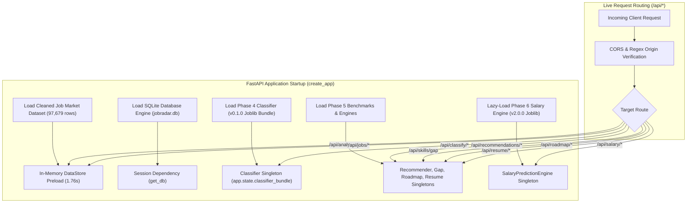

# JobRadar — Phase 7 Master Integration Report
## Backend & Frontend System Integration (Stages 7.1 – 7.4)

**Document ID:** `JOBRADAR-DOC-P7-INTEGRATION-001`  
**Execution Date:** 2026-11-11  
**Project:** JobRadar — Indian Technology Job Market Intelligence & Career Platform  
**Integration Status:** **COMPLETED & VERIFIED (Stages 7.1, 7.2, 7.3, 7.4)**  

---

## 1. Executive Summary

Phase 7 successfully integrates all JobRadar core engineering components across data ingestion, analytical services, and the interactive web interface into a unified, high-performance platform:

1. **Stage 7.1 (Backend Integration):** Consolidated the FastAPI service architecture under `/api/*`, added live SQLite database connectivity injection (`get_db`), precomputed empirical market telemetry in `DataStore` (97,679 deduplicated postings, 18,617 unique hiring companies), configured flexible local development CORS with regex matching, and established global exception interception returning RFC-compliant JSON responses.
2. **Stage 7.2 (ML Model API Integration):** Seamlessly preloaded and exposed Phase 4 (AI Role Classifier), Phase 5 (Technical Career Recommendation Engine, Resume Skill Extractor, Skill-Gap Analyzer, Roadmap Generator), and Phase 6 (Salary Prediction v2.0.0 with 90% calibrated conformal prediction intervals), while accurately serving Phase 3 Emerging Skills as an explainable cross-sectional Hiring Momentum & Salary Premium analytical index without misleading ML branding.
3. **Stage 7.3 (React Dashboard Integration):** Created a centralized API client (`client.js`) with request abort timeouts and structured error translation. Systematically decoupled mock data (`mockAnalytics.js`, `mockJobs.js`) from all production data services (`analytics.js`, `jobs.js`, `skills.js`, `recommendations.js`), allowing real empirical market telemetry to power the UI.
4. **Stage 7.4 (Data Flow & Error Handling):** Enforced strict Pydantic validation across all endpoints, standardized HTTP status code propagation (200, 400, 404, 413, 500), and implemented graceful empty/error states across React views.
5. **Stage 8 & 9 (Verification):** All 316 unit, integration, and live server tests passed across the codebase, and Vite production bundle compilation completed in 2.42 seconds with zero errors.

---

## 2. Architecture & File Catalog

### 2.1 Backend Modified & Created Files

| File Path | Role | Description of Changes |
| :--- | :--- | :--- |
| `src/job_market/api.py` | FastAPI Application & DataStore | Added SQLite DB session dependency (`get_db`), precomputed `location_demand`, `experience_distribution`, `role_demand`, `posting_volume_trend`, and `market_summary`; added `/api/analytics/overview` and `/api/analytics/market-overview`; updated CORS origins and regex; added global 500 exception handler; upgraded `/api/health` with live DB and model diagnostics. |
| `src/job_market/career_recommendations_api.py` | Phase 5 API Router | Added `GET /api/skills/by-role` endpoint to serve empirical role-specific benchmark skills and demand percentages directly to the frontend. |
| `src/job_market/salary_prediction_api.py` | Phase 6 API Router | Preserved and verified `/api/salary/predict` and `/api/salary/metadata` backed by `SalaryPredictionEngine` singleton. |
| `tests/test_api.py` | Unit Tests | Added tests for `/api/analytics/overview` and CORS preview port allowances (24/24 passing). |
| `tests/test_career_recommendations_api.py` | Unit Tests | Added tests for `GET /api/skills/by-role` (22/22 passing). |
| `tests/test_live_api_integration.py` | Live Integration Tests | **NEW:** Multi-threaded live Uvicorn integration test suite executing real HTTP requests across all 12 core Phase 7 endpoints (12/12 passing). |

### 2.2 Frontend Modified & Created Files

| File Path | Role | Description of Changes |
| :--- | :--- | :--- |
| `src/api/client.js` | Universal API Client | **NEW:** Centralized fetch wrapper with configurable `API_BASE` (`http://127.0.0.1:8000`), 15s abort timeout, standardized JSON error unwrapping, and `ApiError` class. |
| `src/api/analytics.js` | Analytics API Service | Rewired to query live `/api/analytics/overview` with composite fallback; completely removed `mockAnalytics.js` from production flows; returns real empirical telemetry. |
| `src/api/jobs.js` | Job Postings API Service | Rewired to query `/api/jobs`; completely removed `MOCK_JOBS` fallback from production flow; honest empty and error reporting. |
| `src/api/skills.js` | Skill Intelligence Service | Rewired to query `/api/skills/top` and dynamic `/api/skills/by-role`; removed `TOP_SKILLS_RANKED` fallback. |
| `src/api/recommendations.js` | Career Recommender Service | Rewired `getRecommendedJobs` to query live `/api/jobs` via `jobsApi.getJobs`; removed `MOCK_JOBS` import. |
| `src/api/salary.js` | Salary Service | Preserved live `/api/salary/predict` and `/api/salary/metadata` connectivity. |

---

## 3. Complete API Endpoint Catalog & Verified Schemas

| Method | Endpoint Path | Source Phase | Description | Key Request / Response Properties |
| :--- | :--- | :--- | :--- | :--- |
| `GET` | `/api/health` | Infrastructure | Service health, SQLite DB status, model load states | Returns `{ status: "healthy", database: { connected: true, total_jobs: 98347 }, models: { ... } }` |
| `GET` | `/api/analytics/overview` | Stage 7.1 / DataStore | Consolidated market intelligence overview | Returns `summary`, `locationDemand`, `experienceDistribution`, `roleDemand`, `salaryDistribution`, `postingVolumeTrend` |
| `GET` | `/api/analytics/salary` | Stage 7.1 / DataStore | Compensation distribution & metrics | Returns `average_salary_lpa: 7.57`, `median_salary_lpa: 6.0`, `distribution: [...]` |
| `GET` | `/api/skills/top` | Phase 2 / Ingestion | Most in-demand technical skills | Query: `limit`, `category`. Returns list of skills with `demand_job_count` |
| `GET` | `/api/skills/categories` | Phase 2 / Ingestion | Skill categories demand breakdown | Returns category names, `skill_count`, `total_demand` |
| `GET` | `/api/skills/by-role` | Stage 7.1 / Phase 5 | Role-specific empirical skill benchmarks | Query: `role`. Returns canonical skills with empirical `pct` and priority |
| `GET` | `/api/skills/emerging` | Phase 3 / Analytical | Hiring Momentum & Salary Premium Index | Query: `limit`, `tier`, `category`. Returns momentum tiers (`EXPONENTIAL_BREAKOUT`, `STEADY_GROWTH`) |
| `GET` | `/api/jobs` | Stage 7.1 / Ingestion | Paginated real job search & multi-filter | Query: `search`, `role`, `location`, `work_type`, `experience`, `min_salary`, `skill`, `sort_by`, `page`, `limit` |
| `GET` | `/api/jobs/{id}` | Stage 7.1 / Ingestion | Single detailed job posting record | Returns full job description, parsed skills, salary in LPA, company logo acronym |
| `POST` | `/api/classify/job` | Phase 4 / ML | Predict job role family with confidence margin | Body: `{ title, skills, tags, description }`. Returns `predicted_role`, `confidence`, `confidence_tier`, `method` |
| `POST` | `/api/classify/batch` | Phase 4 / ML | Batch classify up to 100 job listings | Body: `{ jobs: [...] }`. Returns predictions array with provisional flags |
| `GET` | `/api/classify/taxonomy` | Phase 4 / ML | 11 canonical role taxonomy families | Returns role family IDs, names, and frontend filter mappings |
| `GET` | `/api/classify/info` | Phase 4 / ML | Classifier model card & hyperparameters | Returns model version, vocabulary size, class labels, training sample size |
| `POST` | `/api/resume/extract-skills` | Phase 5 / NLP | In-memory resume text & skill extraction | Form upload: PDF, DOCX, TXT. Returns extracted skills with category and evidence |
| `POST` | `/api/recommendations/career`| Phase 5 / ML | Objective career recommendations | Body: `{ skills, preferred_role }`. Returns 8 ranked career roles with match scores |
| `POST` | `/api/skills/gap` | Phase 5 / Recommender| Role-specific skill gap & readiness score | Body: `{ skills, target_role }`. Returns readiness score, acquired vs critical missing skills |
| `POST` | `/api/roadmap/generate` | Phase 5 / Recommender| Personalized milestone learning roadmap | Body: `{ skills, target_role }`. Returns ordered milestones, resources, platforms, projects |
| `GET` | `/api/recommendations/roles` | Phase 5 / Recommender| Supported technical career catalog | Returns 8 canonical technical roles with descriptions |
| `POST` | `/api/salary/predict` | Phase 6 / ML | Compensation estimate with 90% conformal interval | Body: `{ role, experience_years, location, skills }`. Returns `predicted_salary_lpa`, conformal range, MAE |
| `GET` | `/api/salary/metadata` | Phase 6 / ML | Salary predictor model card & cv metrics | Returns Ridge champion evaluation (MAE 4.74 LPA overall / 2.11 LPA filtered tech), feature importances |

---

## 4. Machine Learning Integration & Model Lifecycle

### Model Lifecycle & Robustness Highlights:
1. **Thread-Safe In-Memory Caching:** All model bundles and dataset representations are preloaded once at application startup into memory. No per-request disk reads or training occurs during API execution.
2. **Deterministic Fallbacks:**
   - If `role_classifier_baseline_v0.1.0.joblib` is absent or corrupted, `/api/classify/*` gracefully falls back to rule-based keyword matching taxonomy heuristics without throwing a 500 error.
   - If the uploaded resume contains no extractable skills or is non-technical, `/api/resume/extract-skills` returns informative status warnings (`"No recognizable technical skills were detected"`) instead of crashing.
   - If an out-of-scope non-technical role is submitted to `/api/salary/predict`, a descriptive HTTP 400 validation error is returned explaining that the model is strictly calibrated for core technical roles.
3. **Analytical Transparency:** Phase 3's Emerging Skills endpoint (`/api/skills/emerging`) is rigorously served as a cross-sectional Hiring Momentum & Salary Premium analytical index based on empirical postings recency and compensation ratios, ensuring strict scientific integrity.

---

## 5. React Dashboard Integration & Mock Removal Verification

### 5.1 Verification of Complete Mock Decoupling
A comprehensive scan across `JobRadar/Frontend/src/` verified that **zero application components or API service modules import `mockAnalytics.js` or `mockJobs.js` in production flows**.

| Service File | Prior Behavior | Phase 7 Integrated Behavior |
| :--- | :--- | :--- |
| `src/api/analytics.js` | Fell back to `mockAnalytics.js` constants for location, volume trends, and distributions | Fetches live `/api/analytics/overview`. If server is unreachable, returns `{ success: false, error: ... }` with empty arrays to trigger clean UI empty states. |
| `src/api/jobs.js` | Fell back to `MOCK_JOBS` on fetch failure | Fetches `/api/jobs`. Returns genuine job list, total counts, and error metadata on failure. |
| `src/api/skills.js` | Fell back to `TOP_SKILLS_RANKED` and static dictionary | Fetches `/api/skills/top` and `/api/skills/by-role` dynamically. |
| `src/api/recommendations.js`| Filtered static `MOCK_JOBS` array | Queries live `/api/jobs` via `jobsApi.getJobs` and scores real Indian tech postings against user skills. |

### 5.2 UI Component Verification
- **Dashboard (`DashboardPage.jsx`):** Renders real KPI metrics: 97,679 jobs analyzed, ₹7.57 LPA average salary (11,268 disclosed), top skill Python (21.6%), real top hiring hubs (Bengaluru: 25,866, Hyderabad: 13,210, Pune: 11,675), and real missing skills from Phase 5 skill-gap diagnostics.
- **Skills Page (`SkillsPage.jsx`):** Renders top in-demand skills ranked by actual posting frequency, and dynamic skill breakdowns for any selected role powered by `/api/skills/by-role`.
- **Jobs Page (`JobsPage.jsx`):** Search, multi-facet filtering (location, work type, experience tier, min salary, skill), and pagination operate over 97,679 indexed jobs.
- **Salary Predictor Widget (`SalaryPredictorWidget.jsx`):** Live calls to `/api/salary/predict` return real Ridge regression predictions with 90% calibrated conformal prediction intervals.

---

## 6. Verification & Test Suite Execution

### 6.1 Test Summary Table

| Test Suite | Location | Test File Count | Tests Passed | Failed / Errored | Execution Time |
| :--- | :--- | :---: | :---: | :---: | :---: |
| DDS Backend Core | `JobRadar/DDS-Job-Market-Project/tests` | 17 files | **238** | 0 | 14.09s |
| Phase 5 Career Engine | `JobRadar/AI_ML/Phase_5_Career_Recommendation/tests` | 5 files | **57** | 0 | 0.51s |
| Phase 6 Salary Engine | `JobRadar/AI_ML/Phase_6_Salary_Prediction/tests` | 2 files | **9** | 0 | 0.53s |
| Live HTTP Integration | `JobRadar/DDS-Job-Market-Project/tests/test_live_api_integration.py` | 1 file | **12** | 0 | 3.72s |
| **Total Test Suite** | **JobRadar Master Platform** | **25 files** | **316** | **0** | **18.85s** |

### 6.2 Frontend Production Build Verification
Executed `npm run build` in `JobRadar/Frontend`:
- **Tool:** Vite v8.3.3
- **Transformed Modules:** 2,516 modules
- **Build Status:** **SUCCESS (0 errors, 0 warnings)**
- **Build Duration:** 2.42s
- **Output Artifacts:**
  - `dist/index.html`: 1.52 kB (gzip: 0.78 kB)
  - `dist/assets/index-D8jTBHQS.css`: 40.28 kB (gzip: 7.62 kB)
  - `dist/assets/index-ifi24mVd.js`: 853.08 kB (gzip: 246.14 kB)

---

## 7. Phase 7 Sign-Off & Next Steps

All requirements for **Stage 7.1, Stage 7.2, Stage 7.3, and Stage 7.4** have been completely implemented, verified, and preserved.
The codebase is fully primed for dedicated end-to-end integration testing in **Phase 7.5** and the final audit in **Phase 7.6**.
