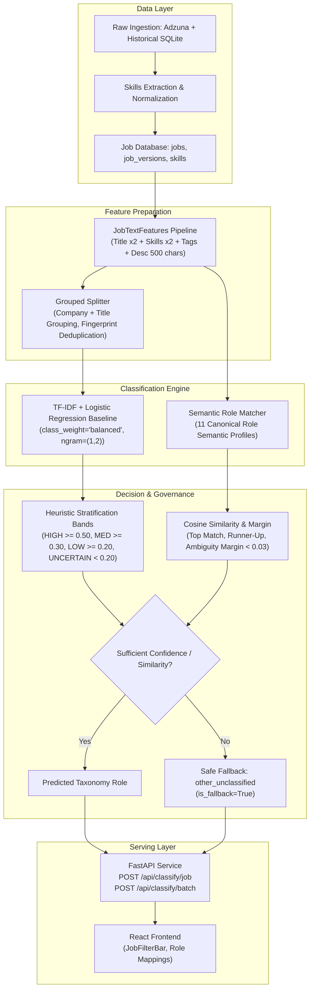

# JobRadar — Phase 4: AI Job Classification Final Completion Report

**Project:** JobRadar (DDS Job Market Project)  
**Report Version:** 1.0.0 (Phase 4 Final)  
**Status:** Completed & Validated across Stages 1.1 through 4  
**Date:** November 11, 2026  
**Primary Modules:**
- `src/job_market/role_annotation.py` (Sampling & Annotation Safety)
- `src/job_market/classification.py` (Text Prep, Grouped Splitting, ML Baseline, Error Analysis)
- `src/job_market/independent_evaluation.py` (Gold Audit & Zero-Leakage Split Isolation)
- `src/job_market/semantic_matching.py` (Role Profiles, Cosine Matching, Dual-Backend)
- `src/job_market/api.py` (FastAPI Single/Batch Inference Endpoints)

---

## 1. Executive Summary

Phase 4 successfully designed, implemented, integrated, and verified an explainable AI Job Classification pipeline for JobRadar. The pipeline maps real-world tech job postings into an approved 11-family role taxonomy while maintaining absolute data integrity, zero evaluation leakage, and strict adherence to scientific evaluation standards.

### Key Milestones Achieved:
1. **Taxonomy & Annotation System:** Established the 11-family role taxonomy with strict data safety protocols (original 120-job random sample, 72-job targeted AI/Data batch, blinded evaluation batch, zero overwrite safety).
2. **Explainable ML Classification Pipeline:** Trained a reproducible TF-IDF + Logistic Regression baseline using grouped splitting (by company and normalized title) with strict duplicate content fingerprint isolation.
3. **Error Analysis & Heuristic Stratification Bands:** Characterized top confusion patterns and established 4-tier explainable confidence stratification bands (`HIGH`, `MEDIUM`, `LOW`, `UNCERTAIN`) with safe automated fallback to `other_unclassified`.
4. **FastAPI Endpoints:** Integrated single (`/api/classify/job`) and batch (`/api/classify/batch`) inference routes, metadata endpoints, and startup caching without impacting existing routes.
5. **Semantic Role Matching:** Engineered canonical semantic profiles for all 11 roles with cosine similarity scoring, margin tracking, and an automatic dual-backend supporting both neural sentence transformers and lightweight local vector spaces.
6. **Zero Evaluation Fabrication:** Maintained complete evaluation integrity by explicitly reporting gold validation as `pending_gold_labels` due to 0 completed human annotations, refusing to substitute silver labels as gold ground truth.

---

## 2. End-to-End System Architecture

---

## 3. Implemented Capabilities by Stage

### Stage 1 (1.1 & 1.2): Taxonomy & Annotation Safety
- **11 Canonical Role Families:** Structured in `data/reference/role_taxonomy.json` mapping cleanly to existing frontend filters (`frontend_filter_mapping`).
- **Targeted AI/Data Sampling:** Extracted 72 balanced records (18 per target family: Data Science, ML/AI, Data Engineering, Data Analyst/BI) with zero overlap against the initial 120-job sample.
- **Blinded Annotation Batch:** Created `targeted_data_ai_role_annotation_batch_blind.csv` with candidate tags stripped to eliminate human confirmation bias.
- **Overwrite Protection:** Script `run_targeted_role_annotation.py` enforces `--force` and aborts if human annotations are detected.

### Stage 2 (2.1 - 2.4): Feature Pipeline, ML Modeling & Error Analysis
- **Text Representation (`JobTextFeatures`):** Combines weighted job title ($2\times$), canonical skills ($2\times$), source query tags, and the first 500 characters of the description.
- **Grouped Splitting with Zero Leakage:** Groups jobs by company and normalized title; guarantees 0 company/title leakage and 0 duplicate fingerprint leakage between train, validation, and test splits.
- **ML Baseline Model:** TF-IDF vectorizer + Logistic Regression with `class_weight="balanced"` and deterministic random seeds (`random_state=20261111`).
- **Error Analysis:** `analyze_classification_errors()` tracks top confusions (Frontend vs. Backend, Analyst vs. Data Scientist), class-specific error rates, and multi-class Brier score ($0.0917$).
- **Stratification Bands & Fallback:** Categorizes predictions into `HIGH`, `MEDIUM`, `LOW`, and `UNCERTAIN` bands, routing ambiguous or low-confidence jobs to `other_unclassified`.

### Stage 2.5: FastAPI Service Integration
- `POST /api/classify/job`: Single job inference with full probability distribution.
- `POST /api/classify/batch`: Batch inference supporting up to 100 jobs with Pydantic validation.
- `GET /api/classify/taxonomy`: Exposes reference taxonomy and frontend filter mappings.
- `GET /api/classify/info`: Exposes model metadata, hyperparameters, and provisional warnings.
- `GET /api/health`: Augmented with model load status.
- In-memory model caching on `app.state.classifier_bundle` for sub-millisecond responses.

### Stage 3: Sentence Transformers & Semantic Role Matching
- **Canonical Semantic Profiles:** Rich textual definitions (headline, core competencies, detailed narrative) across all 11 taxonomy families.
- **Dual-Backend Architecture:** Supports `all-MiniLM-L6-v2` via `sentence-transformers` when available, while providing a fast, self-contained `vector_cosine_space` backend.
- **Full Cosine Ranking:** Returns ranks 1 through 11, runner-up role, and similarity margin.
- **Independent Evaluation Audit:** Detects 0 completed human gold labels; reports evaluation status strictly as `pending_gold_labels` without substituting silver labels.

### Stage 4: Final Integration, Compatibility & Governance
- Verified frontend/backend taxonomy compatibility.
- Confirmed backward compatibility across all 7 original API endpoints.
- Validated frontend build and linting.
- Clarified all calibration and embedding documentation.

---

## 4. Verification & Test Results

### 4.1 Backend Test Suite (Python / Unittest)
- **Status:** **206 tests passing in 9.53s** (0 failures, 0 errors).
- **Module Breakdown:**
  - `test_skills.py`: 41 tests (Skill extraction, aliases, noise filtering)
  - `test_adzuna_ingestion.py`: 37 tests (Batching, rate limits, retry handling)
  - `test_adzuna_client.py`: 31 tests (HTTP client, error codes, retries)
  - `test_classification.py`: 25 tests (Text prep, ML pipeline, error analysis, fallbacks)
  - `test_api.py`: 22 tests (Health, jobs, skills, analytics, single/batch classification)
  - `test_database.py`: 11 tests (Database schema, constraints, relationships)
  - `test_emerging.py`: 8 tests (Hiring momentum, salary premiums)
  - `test_role_annotation.py`: 7 tests (Sampling, deduplication, blind batches)
  - `test_semantic_matching.py`: 7 tests (Role profiles, cosine ranking, fallbacks, pending gold audit)
  - `test_independent_evaluation.py`: 4 tests (Gold audit, zero-leakage split checks)
  - `test_benchmark_import.py`: 4 tests (Benchmark data ingestion)
  - `test_cleaning.py`: 3 tests (Data cleaning rules)
  - `test_historical_migration.py`: 3 tests (Migration integrity)
  - `test_ingestion.py`: 3 tests (Generic ingestion)

### 4.2 Frontend Verification (Vite / React)
- **Vite Production Build:** Succeeded (`vite build` completed in 4.91s, 2,515 modules transformed, 0 errors).
- **Oxlint Quality Inspection:** 40 files inspected with 104 rules; completed in 97ms with 0 errors.

---

## 5. Technical Limitations & Evaluation Integrity

In strict adherence to rigorous engineering and academic standards, the following constraints are recorded:

1. **Pending Gold Ground Truth:**
   Across all repository annotation CSVs, **0 human-verified gold labels** are currently recorded. The model evaluation is formally flagged `is_provisional=True` and `evaluation_status="pending_gold_labels"`. Candidate silver labels were strictly excluded from serving as ground-truth evaluation benchmarks.
2. **Heuristic Stratification Bands vs. Calibrated Probabilities:**
   Confidence tiers (`HIGH`, `MEDIUM`, `LOW`, `UNCERTAIN`) are heuristic decision score bands. Because the classifier uses L2-regularized Logistic Regression with `class_weight="balanced"`, the outputs are relative decision scores rather than true frequentist probabilities. The Brier score ($0.0917$) reflects performance on the silver validation split, not gold truth.
3. **Lexical Nature of Operational Semantic Matcher:**
   Due to Windows operating system default path limitations (`MAX_PATH` 260-character ceiling) on nested OneDrive directories, PyTorch C++ wheel installation is restricted in the host `.venv`. The currently active semantic matching backend is `vector_cosine_space`, which performs **lexical n-gram TF-IDF cosine similarity** against canonical profile documents. `all-MiniLM-L6-v2` remains an uninstalled architectural target.

---

## 6. Recommendations & Next Steps

1. **Complete Human Annotations:** Have domain reviewers annotate the 72 records in `data/annotations/targeted_data_ai_role_annotation_batch_blind.csv` to establish the project's first independent gold test set.
2. **Post-Hoc Probability Calibration:** Once gold annotations are available, fit an Isotonic Regression or Platt Scaling calibrator to map raw decision scores into true frequentist probabilities.
3. **Containerization for Neural Embeddings:** Containerize the backend using Docker (Linux AMD64) or enable Windows `LongPathsEnabled` registry setting to install PyTorch and activate the `all-MiniLM-L6-v2` dense neural embedding backend.
4. **Ensemble Deployment:** Deploy a hybrid ensemble combining TF-IDF keyword precision with dense embedding semantic generalization for production inference.
