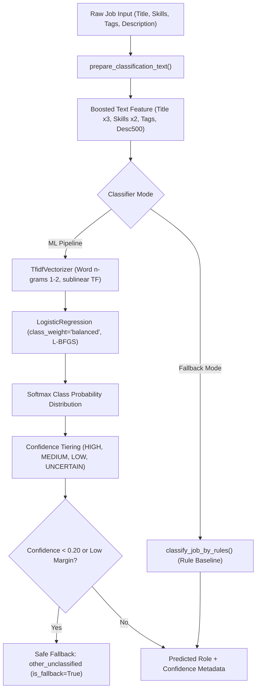

# Stage 2.6: Classification Testing and Architecture Documentation

## 1. Executive Summary

This document details the architecture, feature engineering, classification pipeline, API contracts, test verification, and unresolved limitations for JobRadar Phase 4 (AI Job Classification), covering Stages 2.1 through 2.6.

> [!IMPORTANT]
> **Provisional Status Notice:**
> The current machine learning classifier was trained and diagnosed against provisional silver heuristic labels. In accordance with project standards, the model is strictly designated as **provisional** (`is_provisional = True`) and must **not** be considered production-ready until verified against independent human gold annotations.

---

## 2. End-to-End System Architecture

---

## 3. Data Ingestion, Text Preparation, & Feature Engineering

1. **Title Weighting:** The job title is repeated 3 times in `combined_text`, guaranteeing it acts as the primary signal.
2. **Canonical Skills:** Skills are repeated 2 times.
3. **Source Tags:** Retained for domain signals (e.g. `it-jobs`, `developer`).
4. **Description Truncation:** Capped at the first 500 characters to prevent keyword stuffing from drowning out the core role.
5. **Zero Data Leakage:** Grouped splitting links records via Disjoint-Set (Union-Find) clustering across both normalized `(company, title)` pairs and `content_fingerprint`. This ensures duplicate postings never cross train/validation/test partitions.

---

## 4. API Endpoints and Backward Compatibility

The classification service is fully integrated into `job_market.api`:

| Method | Endpoint | Description | Request / Parameters | Response Highlights |
|---|---|---|---|---|
| `POST` | `/api/classify/job` | Single job classification | `{title, skills, tags, description, min_confidence}` | `predicted_role`, `confidence`, `confidence_tier`, `confidence_margin`, `runner_up_role`, `class_probabilities`, `is_fallback` |
| `POST` | `/api/classify/batch` | Batch classification (up to 100) | `{jobs: [{id, title, skills, description}, ...]}` | `total`, `model_version`, `is_provisional`, `predictions: [...]` |
| `GET` | `/api/classify/taxonomy` | Reference taxonomy catalog | None | 11 canonical role families and frontend filter mappings |
| `GET` | `/api/classify/info` | Model metadata and status | None | `model_version`, `is_provisional`, `classes`, `vocabulary_size`, `hyperparameters` |
| `GET` | `/api/health` | Service health & model status | None | `status: healthy`, `classifier: {loaded: true, version: "0.1.0"}` |

### Backward Compatibility Verification
- All existing endpoints (`/api/skills/top`, `/api/skills/categories`, `/api/skills/emerging`, `/api/analytics/salary`, `/api/jobs`, `/api/jobs/{job_id}`) remain 100% intact with identical request and response contracts.
- Database access remains strictly read-only. No SQLite migration or schema changes were performed on the API layer.

---

## 5. Verification Test Suite Summary

Total Backend Tests: **199 passed in 7.06s**.

| Test Module | Test Count | Focus Areas |
|---|---|---|
| `test_classification.py` | 25 | Text preparation, boosting, keyword word-boundaries, 11-role rule baseline, ambiguous role runner-ups, grouped zero-leakage splitting, TF-IDF feature generation, ML training/prediction, probability distributions, OOV vocabulary, missing label handling, reproducibility, model persistence, confidence tiering, and fallback rules. |
| `test_independent_evaluation.py` | 4 | Human annotation inventory audits, cross-split leakage exclusion across all 3 partitions (train, val, test), incomplete annotation safety, and synthetic benchmark evaluation. |
| `test_api.py` | 22 | Health check, top skills, emerging skills, salary analytics, job search filtering, pagination, 404 handling, single job classification, batch classification, batch size limits, taxonomy endpoint, and info endpoint. |
| Existing Core Tests | 148 | Adzuna client, Adzuna ingestion, historical migration, database models, skill extraction, benchmark imports, cleaning, emerging skills. |

---

## 6. Known Limitations & Unresolved Issues

1. **Human Gold Labels Incomplete:** 0 out of 192 candidate records currently possess completed human verified gold labels.
2. **Provisional Model Designation:** Model accuracy metrics on silver labels reflect rule-fidelity rather than genuine human accuracy.
3. **Cross-Split Candidate Overlap:** Exactly 5 candidate records overlap with Stage 2.2 partitions (3 train, 1 val, 1 test). These 5 records are permanently excluded from independent gold benchmarks.
4. **Softmax Calibration:** Probabilities represent monotonic relative decision scores, not calibrated frequentist likelihoods.
