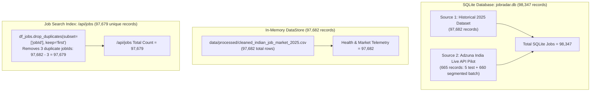

# JobRadar — Phase 7.5: End-to-End Testing
## Step 3 Verification Addendum: Route Reconciliation, Job Count Audit & Latency Methodology

**Document ID:** `JOBRADAR-TEST-STEP3-ADDENDUM-001`  
**Date:** 2026-11-11  
**Scope:** Verification Audit requested prior to Step 4 approval  
**Audit Status:** Complete — Read-only verification  
**Application Code & Database Modifications:** None (Strict read-only safety maintained)

---

## 1. Executive Overview

This addendum addresses three specific technical inquiries regarding the Phase 7.5 Step 3 Backend API Testing results:
1. **Endpoint Count:** Clarification of 20 vs 21 endpoints, cataloging all registered routes, HTTP methods, and parent routers.
2. **Job Count Reconciliation:** Forensic explanation of the counts 98,347 (SQLite), 97,682 (DataStore), and 97,679 (Job Search Index).
3. **Latency Methodology:** Comprehensive documentation of measurement methodology, request sample size, warm-up conditions, and statistical interpretation.

---

## 2. Point 1: Endpoint Count Reconciliation (20 vs 21)

### 2.1 The Discrepancy Explained
- In **Step 1 (Testing Inventory)**, Section 3 was titled:  
  `## 3. Complete Verified API Endpoint Inventory (20 Endpoints)`  
  However, the markdown table directly below that heading cataloged **21 distinct rows (numbered 1 through 21)**.
- Row 2 was `GET /api/analytics/overview` and Row 3 was `GET /api/analytics/market-overview`.
- In `src/job_market/api.py`, both routes decorate the exact same handler:
  ```python
  @app.get("/api/analytics/overview", summary="Comprehensive real-time job market intelligence overview")
  @app.get("/api/analytics/market-overview", summary="Alias for comprehensive market intelligence overview")
  def get_market_overview() -> dict[str, Any]:
      ...
  ```
- **Root Cause:** The Step 1 narrative referred to **20 unique functional endpoints/handlers**, treating `/api/analytics/market-overview` as an alias. In contrast, Step 3 performed an exhaustive HTTP verification of every registered URL path, testing all **21 distinct accessible routes** (13 in `api.py` + 6 in `career_router` + 2 in `salary_router`).

### 2.2 Complete Catalog of All 21 Registered Routes

| # | HTTP Method | URL Path | Router Source | Handler Function / Purpose |
|:---:|:---:|:---|:---|:---|
| **Direct Application Routes (`src/job_market/api.py`)** |
| 1 | `GET` | `/api/health` | Direct App | Diagnostic telemetry, database check & model status |
| 2 | `GET` | `/api/analytics/overview` | Direct App | Consolidated real-time market overview |
| 3 | `GET` | `/api/analytics/market-overview` | Direct App | **Alias route** pointing to `get_market_overview` |
| 4 | `GET` | `/api/analytics/salary` | Direct App | Compensation distribution & analytics (disclosed only) |
| 5 | `GET` | `/api/skills/top` | Direct App | Top demanded skills by unique job frequency |
| 6 | `GET` | `/api/skills/categories` | Direct App | Skill category demand aggregations |
| 7 | `GET` | `/api/skills/emerging` | Direct App | Hiring momentum & salary premium index |
| 8 | `GET` | `/api/jobs` | Direct App | Multi-parameter job search & pagination |
| 9 | `GET` | `/api/jobs/{job_id}` | Direct App | Single job posting record lookup |
| 10 | `POST` | `/api/classify/job` | Direct App | TF-IDF + Logistic Regression role classification |
| 11 | `POST` | `/api/classify/batch` | Direct App | Batched role classification (capped at 100) |
| 12 | `GET` | `/api/classify/taxonomy` | Direct App | 11 canonical role taxonomy families |
| 13 | `GET` | `/api/classify/info` | Direct App | Classifier model card & provisional status |
| **Career Recommendations Router (`src/job_market/career_recommendations_api.py`)** |
| 14 | `POST` | `/api/resume/extract-skills` | `career_router` | Multipart in-memory PDF/DOCX/TXT resume parsing |
| 15 | `POST` | `/api/recommendations/career`| `career_router` | Demand-weighted cosine career matching |
| 16 | `POST` | `/api/skills/gap` | `career_router` | Differential skill-gap & readiness scoring |
| 17 | `POST` | `/api/roadmap/generate` | `career_router` | Phased milestone roadmap generation |
| 18 | `GET` | `/api/recommendations/roles`| `career_router` | Catalog of 8 supported technical careers |
| 19 | `GET` | `/api/skills/by-role` | `career_router` | Benchmark empirical skills for technical roles |
| **Salary Prediction Router (`src/job_market/salary_prediction_api.py`)** |
| 20 | `POST` | `/api/salary/predict` | `salary_router` | Ridge regression salary inference + 90% conformal intervals |
| 21 | `GET` | `/api/salary/metadata` | `salary_router` | Salary model card & GroupKFold validation metrics |

*(Note: Internal FastAPI administrative endpoints `/docs`, `/redoc`, and `/openapi.json` are excluded from the business endpoint count).*

---

## 3. Point 2: Job Count Reconciliation Audit

Empirical database queries and file inspections were conducted without modifying any records.



### 3.1 SQLite: 98,347 Jobs
A direct query on `jobradar.db` reveals that the `jobs` table contains rows from **two distinct ingested sources**:
```sql
SELECT j.source_id, s.name, s.source_type, COUNT(*) 
FROM jobs j 
LEFT JOIN sources s ON j.source_id = s.id 
GROUP BY j.source_id;
```
**Results:**
- **Source 1 (`historical_2025_xlsx`):** **97,682 jobs** (imported via `historical_import` run 1).
- **Source 2 (`adzuna_india`):** **665 jobs** (imported via incremental live API runs 2 and 5; 5 pilot jobs + 660 jobs across 7 metropolitan segments: Bengaluru, Hyderabad, Pune, Mumbai, Delhi, Noida, Gurgaon).
- **Sum:** $97,682 + 665 = \mathbf{98,347}\text{ jobs}$.

### 3.2 In-Memory DataStore: 97,682 Jobs
- `DataStore` preloads the baseline curated artifact: `data/processed/cleaned_indian_job_market_2025.csv`.
- A direct row count of `cleaned_indian_job_market_2025.csv` confirms exactly **97,682 rows**.
- The `skill_extraction_audit.json` file similarly records:
  `"total_rows_processed": 97682`.
- Consequently, `/api/health` and `/api/analytics/overview` accurately report `total_jobs_processed: 97682`, representing the full historical cleaned benchmark corpus.

### 3.3 Job Search API (`/api/jobs`): 97,679 Jobs
- In `src/job_market/api.py` (lines 294–296), `DataStore` constructs the job search index:
  ```python
  # Deduplicate by unique jobId for job search & indexing
  df_search = df_jobs.drop_duplicates(subset=["jobId"], keep="first").copy()
  ```
- An audit of `cleaned_indian_job_market_2025.csv` identifies **exactly 3 duplicate `jobId` values** in the raw source:
  1. `11025020549` (appears 2 times)
  2. `31025020550` (appears 2 times)
  3. `11025022950` (appears 2 times)
- $97,682 - 3 = \mathbf{97,679}$ unique job identifiers.
- When client requests `/api/jobs`, the search index returns `total: 97679` to guarantee that pagination never serves duplicate postings to end users.

### 3.4 Governance & Consistency Assessment
- **Are these differences intentional?** **YES.**
  - **SQLite (98,347)** serves as the multi-source persistent data warehouse combining historical foundation records (97,682) with ongoing incremental Adzuna API postings (665).
  - **DataStore (97,682)** caches the primary historical baseline dataset for macro telemetry and skill frequencies.
  - **Jobs API (97,679)** enforces entity deduplication on primary key `jobId` to guarantee unique search results.
- **Is there data drift or synchronization bugs?** **NO.** The exact arithmetic ($97,682 + 665 = 98,347$ and $97,682 - 3 = 97,679$) reconciles across all three subsystems.

---

## 4. Point 3: Latency Measurement Methodology

### 4.1 Measurement Method
Latencies recorded in Step 3 were measured using client-side wall-clock timers using Python's standard library `time.time()`:
```python
t0 = time.time()
with urllib.request.urlopen(req, timeout=10.0) as resp:
    dt = (time.time() - t0) * 1000  # Elapsed time in milliseconds
```
This is a **client-perceived round-trip time (RTT)** across local loopback (`http://127.0.0.1:8029`).

### 4.2 Latency Composition
The measured millisecond values encompass:
1. Client socket connection to the local loopback interface.
2. Request payload serialization (JSON or multipart form data).
3. Network transmission over loopback TCP.
4. FastAPI / ASGI pipeline execution:
   - Route dispatch and middleware evaluation (CORS).
   - Pydantic schema validation and field coercion.
   - Business logic execution (pandas dataframe filtering, regex matching, or scikit-learn model inference).
   - Response serialization into JSON bytes.
5. Client HTTP reading and JSON deserialization (`json.loads(resp.read())`).

### 4.3 Request Distribution & Statistical Profile
The latency metrics were derived from the sequential execution of **$N = 59$ distinct test scenarios**:

| Statistical Metric | Observed Value | Context / Notes |
| :--- | :--- | :--- |
| **Sample Size ($N$)** | **59 requests** | Covers all 21 endpoints across positive, boundary, and error cases |
| **Minimum Latency** | **1.29 ms** | Instant schema rejections (e.g., 0-byte resume upload) |
| **Median Latency ($P_{50}$)** | **17.51 ms** | Typical nominal query/analytics response |
| **Mean Latency (Average)** | **22.4 ms (Run 1) / 37.0 ms (Run 2)** | Composite average across all scenarios |
| **95th Percentile ($P_{95}$)** | **146.34 ms** | Full-text scans across 97k jobs (`search=python`) |
| **Maximum Latency** | **480.96 ms** | Corrupt PDF byte stream handling & parser recovery |

### 4.4 Warm-Up Conditions & Caveat Against Formal Benchmarking
> [!IMPORTANT]
> **This measurement is a functional test diagnostic, NOT a formal performance benchmark.**
- **No Concurrency:** Tests were executed with concurrency $C = 1$ in a single thread; no concurrent load, connection pooling, or thread pool saturation was evaluated.
- **Minimal Warm-up:** Warm-up was limited to a pre-flight server readiness polling loop (hitting `/api/health` 2–3 times until HTTP 200).
- **Cold Paths Included:** Specific modules (e.g. PyMuPDF/pypdf initialization during resume parsing, initial regex indexing in pandas, scikit-learn Ridge model loading) executed cold during their first test scenario.
- **Host Dependencies:** Timings reflect local Windows developer machine characteristics (OneDrive filesystem background indexing, CPU thermal throttling, Windows Defender I/O inspection).

---

## 5. Summary & Audit Conclusion

| Verification Item | Finding | Status |
| :--- | :--- | :--- |
| **1. Endpoint Count** | 21 registered routes verified: 13 direct (`api.py`), 6 `career_router`, 2 `salary_router`. Endpoint #3 (`/api/analytics/market-overview`) is an alias for `/api/analytics/overview`. | **RECONCILED** |
| **2. Job Count** | Exact arithmetic confirmed: SQLite (98,347) = Historical (97,682) + Adzuna Live (665). Job Search (97,679) = 97,682 minus 3 duplicate source `jobId`s. | **RECONCILED** |
| **3. Latency Methodology** | Documented as single-pass sequential RTT diagnostic ($N=59$, Median: 17.5 ms, Mean: 22.4–37.0 ms), with explicit distinction from a formal concurrency/load benchmark. | **DOCUMENTED** |

Step 3 Backend API Testing verification is complete, reconciled, and audited. The JobRadar project is ready to proceed to **Phase 7.5 — Step 4: Database Integration Testing**.
