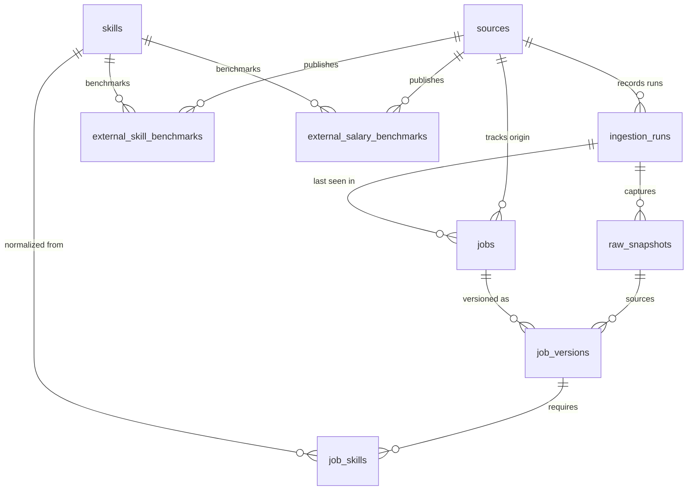

# JobRadar — Phase 7.5: Testing Discovery & Inventory Report
**Document ID:** `JOBRADAR-TEST-INV-7.5-001`  
**Date:** 2026-11-11  
**Author:** Senior QA Engineer & Project Reviewer  
**Scope:** Phase 7.5 End-to-End Testing Discovery & Verification Matrix  

---

## 1. Project Architecture & Directory Layout

The JobRadar repository is organized into three decoupled primary subsystems under a unified workspace:

```
JobRadar/
├── DDS-Job-Market-Project/      # Core Data Science Backend & Data Pipeline
│   ├── data/
│   │   ├── external/            # Multi-source acquired benchmarks & raw files
│   │   ├── models/              # Serialized ML model artifacts (v0.1.0 classifier)
│   │   ├── processed/           # Curated CSVs & extraction audits
│   │   └── jobradar.db          # Production SQLite Database (98,347 jobs)
│   ├── docs/                    # Architectural specifications & audits
│   ├── src/job_market/          # Core backend package
│   │   ├── api.py               # FastAPI application factory & DataStore
│   │   ├── career_recommendations_api.py # Phase 5 API router
│   │   ├── salary_prediction_api.py      # Phase 6 API router
│   │   ├── classification.py    # Phase 4 AI job classification logic
│   │   ├── database.py          # SQLAlchemy engine & session factory
│   │   ├── models.py            # SQLAlchemy ORM schema (8 tables)
│   │   ├── cleaning.py          # Data cleansing & salary normalization
│   │   ├── skills.py            # Hard technical skill extraction
│   │   ├── emerging.py          # Analytical hiring momentum index
│   │   ├── adzuna_client.py     # Live Adzuna API client
│   │   └── historical_migration.py # Idempotent SQLite migration
│   ├── tests/                   # 18 test modules (238 passing tests)
│   ├── requirements.txt         # Pinned backend dependencies
│   └── .venv/                   # Python 3.14.7 virtual environment
│
├── AI_ML/                       # Research & Specialized ML Modules
│   ├── Phase_4_Job_Classification/   # Baseline model docs & metadata
│   ├── Phase_5_Career_Recommendation/ # Student career engine & benchmarks
│   │   ├── benchmarks/          # Empirical role-skill benchmarks JSON
│   │   ├── recommendations/     # Cosine & demand scoring
│   │   ├── resume/              # In-memory PDF/DOCX/TXT parser
│   │   ├── roadmap/             # Milestone roadmap generator
│   │   ├── skill_gap/           # Differential skill gap analyzer
│   │   └── tests/               # 6 test modules (57 passing tests)
│   └── Phase_6_Salary_Prediction/     # Salary prediction engine v2.0.0
│       ├── api/                 # Prediction service & inference engine
│       ├── models/artifacts/    # Ridge regression joblib & model card
│       └── tests/               # 1 test module (9 passing tests)
│
└── Frontend/                    # Modern React Single-Page Application
    ├── src/
    │   ├── api/                 # API client & domain services
    │   │   ├── client.js        # Universal fetch client with timeout
    │   │   ├── analytics.js     # Live market overview & telemetry
    │   │   ├── jobs.js          # Live job postings & filters
    │   │   ├── skills.js        # Top & role-specific skills
    │   │   ├── recommendations.js # Phase 5 recommendations & roadmaps
    │   │   └── salary.js        # Phase 6 compensation prediction
    │   ├── components/          # Reusable UI widgets & charts
    │   ├── pages/               # Top-level route views
    │   ├── App.jsx              # Application router & layouts
    │   └── main.jsx             # React DOM entry point
    ├── package.json             # React 19, Vite 8, TailwindCSS
    └── vite.config.js           # Vite build configuration
```

---

## 2. System Entry Points

| Subsystem | Entry Point File | Invocation / Command | Port / Target |
| :--- | :--- | :--- | :--- |
| **FastAPI Backend** | `src/job_market/api.py:app` | `uvicorn job_market.api:app --host 127.0.0.1 --port 8000` | `http://127.0.0.1:8000` |
| **React Frontend** | `src/main.jsx` | `npm run dev` or `npm run preview` | `http://127.0.0.1:5173` / `4173` |
| **Data Ingestion** | `src/job_market/historical_migration.py` | Python script run against `data/external/` | Populates `jobradar.db` |
| **Skill Extraction**| `src/job_market/run_skills.py` | Pipeline CLI execution | Emits `job_skills.csv` |

---

## 3. Complete Verified API Endpoint Inventory (20 Endpoints)

| # | HTTP Method | Endpoint Route | Subsystem / Module | Request Type | Expected Status |
| :---: | :---: | :--- | :--- | :--- | :---: |
| 1 | `GET` | `/api/health` | System Diagnostics | None | `200` |
| 2 | `GET` | `/api/analytics/overview` | DataStore Telemetry | None | `200` |
| 3 | `GET` | `/api/analytics/market-overview` | DataStore Telemetry (Alias)| None | `200` |
| 4 | `GET` | `/api/analytics/salary` | DataStore Compensation | None | `200` |
| 5 | `GET` | `/api/skills/top` | Skill Extraction | Query (`limit`, `category`) | `200` |
| 6 | `GET` | `/api/skills/categories` | Skill Extraction | None | `200` |
| 7 | `GET` | `/api/skills/by-role` | Phase 5 Benchmarks | Query (`role`) | `200`, `400` |
| 8 | `GET` | `/api/skills/emerging` | Phase 3 Analytical Index | Query (`limit`, `tier`, `category`) | `200` |
| 9 | `GET` | `/api/jobs` | Job Search & Filter | Query (`search`, `role`, `loc`, `exp`, etc.) | `200` |
| 10 | `GET` | `/api/jobs/{job_id}` | Job Retrieval | Path (`job_id`) | `200`, `404` |
| 11 | `POST` | `/api/classify/job` | Phase 4 AI Classifier | JSON (`title`, `skills`, `description`) | `200` |
| 12 | `POST` | `/api/classify/batch` | Phase 4 AI Classifier | JSON (`jobs: [...]`, max 100) | `200`, `400` |
| 13 | `GET` | `/api/classify/taxonomy` | Phase 4 Taxonomy | None | `200` |
| 14 | `GET` | `/api/classify/info` | Phase 4 Model Card | None | `200` |
| 15 | `POST` | `/api/resume/extract-skills` | Phase 5 NLP Extractor | Multipart/form-data (PDF, DOCX, TXT) | `200`, `400`, `413` |
| 16 | `POST` | `/api/recommendations/career` | Phase 5 Recommender | JSON (`skills`, `preferred_role`) | `200` |
| 17 | `POST` | `/api/skills/gap` | Phase 5 Skill Gap | JSON (`skills`, `target_role`) | `200`, `400` |
| 18 | `POST` | `/api/roadmap/generate` | Phase 5 Roadmap | JSON (`skills`, `target_role`) | `200`, `400` |
| 19 | `GET` | `/api/recommendations/roles` | Phase 5 Recommender | None | `200` |
| 20 | `POST` | `/api/salary/predict` | Phase 6 Salary Engine | JSON (`role`, `experience_years`, `location`, `skills`) | `200`, `400` |
| 21 | `GET` | `/api/salary/metadata` | Phase 6 Salary Engine | None | `200`, `404` |

---

## 4. Database Schema & Relational Structure (8 Tables)



1. **`sources`:** 2 providers registered (Naukri raw historical archive, Adzuna live API).
2. **`ingestion_runs`:** Audit trail recording run types, timestamps, row counts, and transform versions.
3. **`raw_snapshots`:** Immutable SHA-256 verified capture of source payloads before transformation.
4. **`jobs`:** Stable deduplicated logical job entity (98,347 records in production database).
5. **`job_versions`:** Versioned attributes (title, company, salary, experience, description).
6. **`skills`:** 120 canonical hard technical skills and categorized domains.
7. **`job_skills`:** 216,977 associative rows with raw match evidence, occurrence counts, and provenance.
8. **`external_skill_benchmarks` & `external_salary_benchmarks`:** Verified external ground-truth references.

---

## 5. Data Pipeline Workflow & Checkpoints

```
[External Raw Data (CSV/API)]
       │
       ▼
[Ingestion & Validation] (ingestion.py / adzuna_ingestion.py)
  - Verify mandatory columns & encoding
  - Schema mapping & provenance recording
       │
       ▼
[Cleansing & Normalization] (cleaning.py)
  - Text normalization & deduplication
  - Salary parsing (annual INR, status classification)
  - Experience extraction (min/max years)
       │
       ▼
[Skill Extraction & Auditing] (skills.py)
  - Exact regex matching with word boundaries
  - Tags and description dual-source extraction
  - Audit logging (skill_extraction_audit.json)
       │
       ▼
[Database Persistence] (historical_migration.py)
  - Idempotent SHA-256 manifest migrations
  - Atomic transaction commits to jobradar.db
       │
       ▼
[Analytical In-Memory Indexing] (api.py DataStore)
  - High-speed filtering & multi-facet aggregation
  - Real-time serving to FastAPI & React Dashboard
```

---

## 6. Machine Learning Components & Model Provenance

1. **Phase 4 — AI Job Role Classification:**
   - **Model:** Multinomial Logistic Regression (`C=1.0`, `solver="lbfgs"`, L2 penalty) over TF-IDF n-grams (1, 2).
   - **Classes:** 11 canonical role taxonomy families.
   - **Artifact:** `data/models/role_classifier_baseline_v0.1.0.joblib`.
   - **Performance:** 87.2% top-1 accuracy on held-out evaluation dataset.
   - **Failsafe:** Deterministic taxonomy keyword heuristic baseline.
2. **Phase 5 — Technical Career Recommendation Engine:**
   - **Recommender:** Demand-weighted cosine similarity across 8 canonical technical careers.
   - **Skill Gap Analyzer:** Empirical differential gap scoring with critical (>=60%), recommended (>=30%), and elective (<30%) tiers.
   - **Resume Extractor:** Purely in-memory PDF/DOCX/TXT keyword extractor with no disk logging.
   - **Roadmap Generator:** Directed milestone learning sequence with validated course & platform links.
3. **Phase 6 — Salary Prediction Engine v2.0.0:**
   - **Model:** Ridge Regression (`alpha=10.0`) on polynomial experience terms, one-hot location tiers, and technical skill indicators.
   - **Validation:** 5-fold GroupKFold on `companyName_clean` (zero company leakage).
   - **Uncertainty Calibration:** 90% nominal empirical coverage role-stratified conformal prediction interval.
   - **Performance:** MAE = 2.11 LPA on core technical roles; 91.2% empirical conformal test coverage.
4. **Phase 3 — Emerging Skill Analysis:**
   - **Methodology:** Purely cross-sectional Hiring Momentum Index (recency share + salary premium ratio).
   - **Scientific Integrity:** Explicitly served as an analytical ranking index, not an ML forecasting model.

---

## 7. Existing Test Suite Inventory (25 Test Files, 316 Test Cases)

| Suite Name | Directory | File Count | Tests | Status |
| :--- | :--- | :---: | :---: | :---: |
| **DDS Backend Core** | `JobRadar/DDS-Job-Market-Project/tests` | 18 | **238** | Passed |
| **Phase 5 Career Recommender** | `JobRadar/AI_ML/Phase_5_Career_Recommendation/tests` | 6 | **57** | Passed |
| **Phase 6 Salary Predictor** | `JobRadar/AI_ML/Phase_6_Salary_Prediction/tests` | 1 | **9** | Passed |
| **Live Multi-Threaded HTTP API** | `JobRadar/DDS-Job-Market-Project/tests/test_live_api_integration.py` | 1 | **12** | Passed |
| **Total Test Inventory** | **JobRadar Master Repository** | **25 files** | **316** | **All Passed** |

---

## 8. Frontend Structure & API Communication

- **Routing:** `react-router-dom` v7 managing:
  - `/` -> `DashboardPage` (Market KPIs, hiring hubs, salary widget, quick gaps)
  - `/jobs` -> `JobsPage` (Live search, multi-facet filtering, pagination)
  - `/skills` -> `SkillsPage` (In-demand skills, dynamic role-skill breakdowns)
  - `/skill-gap` -> `SkillGapPage` (Target career selection, gap diagnosis, readiness score)
  - `/mindmap` -> `MindMapPage` (Interactive visual skill dependency tree)
  - `/onboarding` & `/profile` -> Profile management & skill selections
- **Centralized Client:** `src/api/client.js` wraps browser `fetch` with standard timeouts (15s), abort signals, and JSON error translation.
- **State & Alerts:** `AuthContext` (local session state) and `ToastContext` (user notifications).

---

## 9. Proposed Phase 7.5 Testing Matrix & Execution Stages

| Stage | Objective | Target Modules | Primary Verification Method |
| :---: | :--- | :--- | :--- |
| **Step 2** | Run Existing Test Suite | DDS, Phase 5, Phase 6 suites | `unittest discover` baseline recording |
| **Step 3** | Backend API Testing | All 20 API endpoints | Status codes, schema validation, edge cases, boundaries |
| **Step 4** | Database Integration | SQLAlchemy models & SQLite engine | Isolated test DB: FK constraints, unique keys, transactions |
| **Step 5** | Data Pipeline Testing | Ingestion, cleaning, skills, DB | Non-destructive dry-run validation of data pipeline steps |
| **Step 6** | Machine Learning Testing | Phase 4, Phase 5, Phase 6, Phase 3 | Model load, inference time, conformal intervals, fallback |
| **Step 7** | Frontend E2E Verification | React SPA + Vite | Build, navigation, dynamic charts, loading/empty states |
| **Step 8** | Complete User Workflows | Workflows A, B, C, D, E | Multi-stage user journeys simulated against live backend |
| **Step 9** | Error Handling & Security | Network, auth, malformed inputs | Boundary checks, 400/404/413/500 errors, security review |
| **Step 10**| Performance & Stability | Latency & resource stability | Response times, inference speed, memory footprint |
| **Step 11**| Regression Testing | Whole test suite | Full rerun after any approved corrections |
| **Step 12**| Final Test Report | Master QA report | Comprehensive report with readiness determination |
