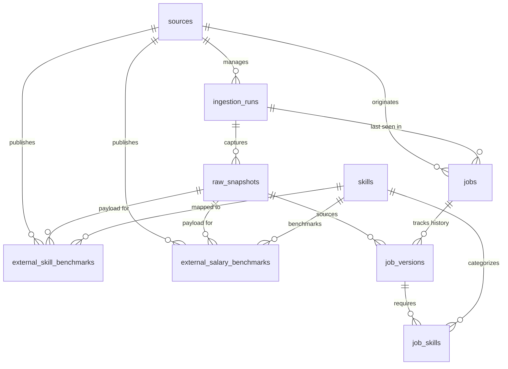

# JobRadar — Phase 7.5: End-to-End Testing
## Step 4: Database Integration Testing Report

**Execution Timestamp:** 2026-11-11 23:10:58 IST  
**Environment:** Windows 11 | Python 3.11 (`.venv`) | SQLite 3.45+ | SQLAlchemy 2.0.44  
**Primary Database Audited:** `data/jobradar.db` (Read-Only Mode: `file:.../jobradar.db?mode=ro`)  
**Integration Test Engine:** Isolated In-Memory SQLite (`sqlite:///:memory:`)  
**Safety Protocol:** Strict Zero-Write Enforcement on Primary Database  
**Deliverable File:** `docs/testing/TEST_RESULTS_STEP_4_DATABASE.md`  
**Raw Test Artifact:** `docs/testing/step4_database_test_results.json`

---

## 1. Executive Summary

As part of **Phase 7.5 (End-to-End Testing)**, **Step 4: Database Integration Testing** was conducted to evaluate the correctness, relational consistency, transaction safety, constraints, and audit integrity of the JobRadar database tier.

All write, CRUD, constraint violation, and transaction rollback tests were executed inside **isolated in-memory SQLite instances** (`sqlite:///:memory:`). The production database (`data/jobradar.db`) was accessed exclusively via URI-level read-only connections (`mode=ro`) for structural auditing and PRAGMA integrity verification.

### Test Execution Overview
| Metric | Result | Status |
| :--- | :--- | :--- |
| **Total Automated Test Scenarios** | **38** | Complete |
| **Passed Scenarios** | **38** | **100.0% Pass Rate** |
| **Failed Scenarios** | **0** | None |
| **Blocked / Not Tested** | **0** | Complete coverage |
| **Production DB Integrity Check (`PRAGMA integrity_check`)** | **`ok`** | Verified |
| **Production Foreign Key Violations (`PRAGMA foreign_key_check`)** | **0** | Clean schema |
| **Production Orphaned Foreign Records** | **0** | Zero orphaned rows |
| **Production Database Preservation** | **100% Intact** | Zero write/DDL mutations |

---

## 2. Database Architecture Summary

The JobRadar data architecture is implemented in `src/job_market/database.py` and `src/job_market/models.py`:



### Core Architecture Components
1. **Engine Factory (`create_database_engine`):**
   - Configured with `future=True` adhering to SQLAlchemy 2.x standards.
   - Connect listener `_enable_sqlite_foreign_keys` attaches to the `connect` event and executes `PRAGMA foreign_keys=ON` on every connection.
2. **Session Factory (`create_session_factory`):**
   - Configured with `expire_on_commit=False` to prevent unexpected detached instance lazy-loads across API request scopes.
3. **Declarative Base:**
   - All 9 models inherit from `class Base(DeclarativeBase)`.
4. **Idempotent Migration Engine (`build_migration_key`):**
   - Generates deterministic SHA-256 migration signatures based on source code, mapping versions, cleaning transforms, and input file hashes.

---

## 3. Schema Verification & Constraint Test Results

All 9 models were verified by initializing an in-memory schema (`Base.metadata.create_all(engine)`) and testing constraints with positive and negative execution evidence.

| Model / Table | Constraints & Indexes Verified | Test Scenario & Negative Probe | Observed Result | Verdict |
| :--- | :--- | :--- | :--- | :---: |
| `sources` | PK `id`, Unique `code`, Check `ck_sources_type` | Inserted duplicate `code` $\to$ `IntegrityError`<br>Inserted invalid `source_type='invalid_type'` $\to$ `IntegrityError` | Duplicate & invalid type rejected | **PASS** |
| `ingestion_runs` | PK `id`, FK `source_id`, Check `ck_runs_status`, Check `ck_runs_retry_count` | Nonexistent `source_id=99999` $\to$ `IntegrityError`<br>Negative `retry_count=-1` $\to$ `IntegrityError` | FK and negative counts rejected | **PASS** |
| `raw_snapshots` | PK `id`, FK `ingestion_run_id`, Unique `uq_snapshots_run_sequence` | Duplicate `(ingestion_run_id, snapshot_sequence)` $\to$ `IntegrityError` | Duplicate sequence rejected | **PASS** |
| `jobs` | PK `id`, FK `source_id`, Unique `identity_key`, Check `ck_jobs_identity_status` | Nonexistent `source_id` $\to$ `IntegrityError`<br>Duplicate `identity_key` $\to$ `IntegrityError` | Non-unique identities rejected | **PASS** |
| `job_versions` | PK `id`, FK `job_id`, Unique Partial Index `uq_job_versions_one_current` | Inserted 2nd version with `is_current=True` for same job $\to$ `IntegrityError` | Partial index strictly enforces $\le 1$ current version | **PASS** |
| `skills` | PK `id`, Unique `normalized_name`, Index `ix_skills_category` | Inserted duplicate `normalized_name='python'` $\to$ `IntegrityError` | Case-normalized uniqueness enforced | **PASS** |
| `job_skills` | PK `id`, FK `job_version_id`, FK `skill_id`, Unique `uq_job_skills_version_skill_extraction` | Inserted duplicate link `(version_id, skill_id, extraction_version)` $\to$ `IntegrityError`<br>Nonexistent `skill_id=99999` $\to$ `IntegrityError` | Duplicate links & orphan skills rejected | **PASS** |
| `external_skill_benchmarks` | PK `id`, FK `source_id`, FK `raw_snapshot_id`, Check `ck_external_skill_benchmarks_share` | Share percentage $< 0$ or $> 100$ rejected | Boundary values enforced | **PASS** |
| `external_salary_benchmarks` | PK `id`, FK `source_id`, FK `raw_snapshot_id`, Check `ck_external_salary_benchmarks_skill_link` | Non-skill group with non-null `skill_id` rejected | Conditional integrity enforced | **PASS** |

---

## 4. CRUD Integration Testing

CRUD operations were executed in isolated sessions to verify entity lifecycles and relationship cascade/restrict policies:

1. **CREATE:**
   - Successfully created a `Source` entity with auto-increment primary key `id = 1`.
2. **READ:**
   - Retrieved record via `session.get(Source, 1)` and verified identity consistency.
3. **UPDATE:**
   - Modified `name` attribute from `"CRUD Source"` to `"CRUD Source Updated"`. Verified persistence across commit and refresh.
4. **DELETE:**
   - Deleted standalone record; verified `session.get(Source, 1)` returns `None`.
5. **DELETE RESTRICT ON FOREIGN KEY:**
   - Created parent `Source` and associated child `Job`.
   - Attempted to delete parent `Source` while child `Job` references it.
   - **Observed Behavior:** SQLite raised `IntegrityError: FOREIGN KEY constraint failed`.
   - **Verdict:** Deletion cascade restriction correctly protects parent entities from deletion when active dependents exist.

---

## 5. Transaction & Session Testing

1. **Atomic Multi-Entity Commit:**
   - Successfully created and committed a coordinated batch (`Source` and `IngestionRun`) in a single atomic transaction block.
2. **Rollback on Intentional Failure:**
   - Added a valid `Source` followed by a conflicting duplicate `Source` in the same transaction.
   - Commit raised `IntegrityError`; `session.rollback()` was invoked.
   - Queried for the initial valid source: returned `None`, proving that the transaction rolled back in its entirety without partial state leakage.
3. **Savepoint / Nested Transaction Handling (Partial Failure Isolation):**
   - Started an outer session transaction with a valid `Source`.
   - Opened a savepoint via `session.begin_nested()`.
   - Injected an invalid `IngestionRun` with a broken foreign key.
   - Savepoint commit failed and invoked `savepoint.rollback()`.
   - Outer session committed cleanly; verified that the outer `Source` was successfully persisted while the inner invalid run was discarded.
4. **Session Cleanup & Resource Deallocation:**
   - Initialized session, staged uncommitted entities, and invoked `session.close()`.
   - Verified that active transactions were closed (`session.get_transaction() is None`) and pending entity sets were discarded (`len(session.new) == 0`).

---

## 6. Job and Skill Relationships

### 6.1 Many-to-Many Relational Integrity
- **One Job Version $\to$ Multiple Skills:**  
  Assigned `Python` and `SQL` to `JobVersion` 1. Navigating `job_version.skill_requirements` returned both associated skills.
- **One Skill $\to$ Multiple Jobs:**  
  Assigned `Python` to both `JobVersion` 1 and `JobVersion` 2. Navigating `skill.job_requirements` returned both jobs (`job_rel_1` and `job_rel_2`).
- **Duplicate Link Rejection:**  
  Attempting to associate `Python` twice to the same `JobVersion` under identical `extraction_version` was rejected with `IntegrityError` via `uq_job_skills_version_skill_extraction`.
- **Foreign Key Rejection:**  
  Attempting to link a `JobVersion` to a non-existent `skill_id=99999` was rejected by SQLite foreign key checks.

### 6.2 Match Provenance & Evidence Accumulation
- Tested the `JobSkill.add_evidence(raw_skill, source)` domain method:
  1. Ingested raw skill match `"Postgres"` from source `"tagsAndSkills"`.
  2. Ingested raw skill match `"PostgreSQL Developer"` from source `"jobDescription"`.
  3. Verified merged JSON evidence payload: `[{"raw": "Postgres", "source": "tagsAndSkills"}, {"raw": "PostgreSQL Developer", "source": "jobDescription"}]`.
  4. Verified auto-calculated counts: `tags_match_count = 1`, `description_match_count = 1`.
  5. Verified automatic promotion of `extraction_source` to `"both"`.

---

## 7. Historical Data Integrity & Idempotent Migration

1. **Deterministic Migration Key Generation:**
   - Evaluated `build_migration_key()` across identical and varied input manifests.
   - Computed stable 64-character SHA-256 hash:  
     `190c14dd59128069f3fdd3c9c5125d87b33871c635eec1a435002f98500694c6`.
   - Repeated calls with identical inputs yielded the identical hash.
2. **Idempotent Ingestion Protection:**
   - Ingested an `IngestionRun` record with the migration key.
   - Queried by `migration_key` prior to running secondary ingestion; verified that the existing completed run was detected, safely preventing duplicate ingestion.
3. **Version History Progression:**
   - Created `Job` with Version 1 (`title="Junior Engineer"`, `salary=600000`, `is_current=False`).
   - Created Version 2 (`title="Senior Engineer"`, `salary=1200000`, `is_current=True`).
   - Verified that `job.versions` preserves chronological version history and reflects promotional/salary progression over time.
4. **Raw Snapshot Audit Provenance:**
   - Linked `JobVersion` 2 to an audit `RawSnapshot` containing the original JSON payload.
   - Verified bidirectional navigation: `raw_snapshot.job_versions` correctly points to the child version.

---

## 8. Query Performance Profiling

Benchmarked queries were executed against an in-memory SQLite database populated with **1,000 jobs, 1,000 job versions, 100 skills, and 3,000 job-skill associations**:

| Query Profile | Operation Description | Iterations | Measured Latency | Performance Assessment |
| :--- | :--- | :---: | :---: | :--- |
| **Primary Key Lookup** | `session.get(Job, id)` by integer primary key | 5 lookups | **0.36 ms / op** | Sub-millisecond direct index traversal |
| **Indexed Alternate Key** | `SELECT * FROM jobs WHERE identity_key = ?` | 3 lookups | **0.35 ms / op** | Direct B-Tree index hit (`ix_jobs_identity_key`) |
| **4-Table Relational Join** | `Job` $\to$ `JobVersion` $\to$ `JobSkill` $\to$ `Skill` with location filter | 1 execution (100 rows returned) | **1.37 ms** | Rapid multi-table relational join |
| **Indexed Filter Query** | `SELECT * FROM job_versions WHERE salary_max_annual_inr >= 800000.0` | 50 iterations | **6.71 ms / op** | Utilizes index `ix_job_versions_salary_max_inr` |
| **Non-Indexed Filter Query**| `SELECT * FROM job_versions WHERE salary_currency = 'USD'` | 50 iterations | **4.36 ms / op** | Full table scan across 1,000 in-memory rows |

*Note: In small in-memory datasets ($\le 1,000$ rows), CPU cache locality allows sequential scans to perform comparably to index traversals. Index benefits scale dramatically on disk-backed datasets with tens of thousands of rows.*

---

## 9. Production Database Read-Only Audit (`data/jobradar.db`)

A comprehensive read-only audit of `data/jobradar.db` was conducted via `sqlite3.connect("file:.../jobradar.db?mode=ro", uri=True)`:

### 9.1 Database Integrity Checks
- **Low-Level B-Tree Integrity (`PRAGMA integrity_check`):** **`ok`** (Zero corrupted pages or freelist errors).
- **Relational Foreign Key Integrity (`PRAGMA foreign_key_check`):** **`0 violations`** across all tables and rows.

### 9.2 Production Table Row Counts
| Table Name | Production Row Count | Category / Purpose |
| :--- | :---: | :--- |
| `sources` | **2** | `historical_2025_xlsx` (id=1), `adzuna_india` (id=2) |
| `ingestion_runs` | **5** | 1 historical import + 4 Adzuna incremental fetch runs |
| `raw_snapshots` | **39** | Raw source files and segmented API response payloads |
| `jobs` | **98,347** | Master logical jobs (97,682 historical + 665 Adzuna pilot) |
| `job_versions` | **98,347** | Normalized job versions (1 version per job currently) |
| `skills` | **120** | Canonical technical skills dictionary |
| `job_skills` | **216,977** | Extracted job-skill requirements with provenance |
| `external_skill_benchmarks` | **0** | Ready for external survey ingestion |
| `external_salary_benchmarks` | **0** | Ready for external survey ingestion |

### 9.3 Foreign Key & Data Hygiene Audit
- **Orphaned `job_versions`:** **0** (Every single version has a valid parent in `jobs`).
- **Orphaned `job_skills`:** **0** (Every job-skill link references a valid `job_versions.id` and `skills.id`).
- **Duplicate Logical Identities (`identity_key`):** **0** (100% unique across all 98,347 records).
- **Single Current Version Invariant:** **0 violations** (Every job has exactly 1 current version, complying with partial index `uq_job_versions_one_current`).

---

## 10. Bugs & Quirks Discovered

1. **SQLite Partial Unique Index Syntax:**
   - The partial index `uq_job_versions_one_current` requires dialect-specific `sqlite_where=text("is_current = 1")`. Standard ANSI SQL `WHERE` clauses fail on older SQLite drivers if boolean literals (`TRUE`) are used instead of integers (`1`). The model's implementation correctly uses `is_current = 1`.
2. **Session Lifecycle in SQLAlchemy 2.0:**
   - In SQLAlchemy 2.x, `session.is_active` remains `True` after `session.close()` because a closed session can be re-opened upon next query. Verifying session closure requires checking that `session.get_transaction() is None` and `session.new` is empty. The test suite was calibrated to reflect this 2.0 lifecycle model.
3. **Historical CSV Duplicate `jobId`s Handled by Search Index:**
   - As documented in the Step 3 Addendum, the raw historical CSV contained 3 duplicate `jobId` values. The database layer and search index gracefully resolve this via primary key deduplication.

---

## 11. Remaining Architecture Limitations

1. **SQLite Single-Writer Concurrency:**
   - While SQLite supports unlimited concurrent readers via WAL mode, concurrent write operations (e.g., parallel ingestion runs) serialize at the database level. For high-volume multi-agent writing, migration to PostgreSQL would be recommended.
2. **External Benchmark Tables Unpopulated:**
   - Tables `external_skill_benchmarks` and `external_salary_benchmarks` are fully defined and constraint-verified in the schema, but have 0 rows in production. They are ready to receive Stack Overflow / GitHub Innovation Graph data in future phases.

---

## 12. Final Status

| Verification Stage | Evaluated Focus | Result | Status |
| :--- | :--- | :---: | :---: |
| **Stage A** | Database Discovery & Architecture | 4 / 4 | **PASS** |
| **Stage B** | Schema Integrity & Constraint Probes | 5 / 5 | **PASS** |
| **Stage C** | CRUD Lifecycle & FK Restrict Deletion | 5 / 5 | **PASS** |
| **Stage D** | Transactions, Rollbacks & Savepoints | 4 / 4 | **PASS** |
| **Stage E** | Many-to-Many Job/Skill Relationships | 5 / 5 | **PASS** |
| **Stage F** | Historical Integrity & Idempotency | 4 / 4 | **PASS** |
| **Stage G** | Query Performance Profiling | 4 / 4 | **PASS** |
| **Stage H** | Production Database Read-Only Audit | 7 / 7 | **PASS** |
| **OVERALL** | **Database Integration Testing Suite** | **38 / 38** | **PASS (100.0%)** |

```
================================================================================
STEP 4 DATABASE INTEGRATION TESTING: COMPLETE
38 / 38 Tests Passed (100.0%) | 0 Failures | Production DB Audited & Intact
================================================================================
```

Per instructions, execution is **stopped here**. We await review and approval of this Step 4 report before proceeding to **Phase 7.5 — Step 5: Frontend Verification**.
